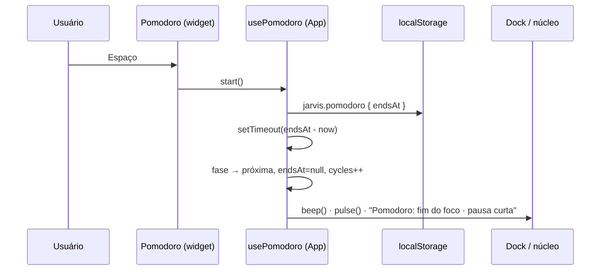

# Widget: Pomodoro

Widget de foco e pausa no método Pomodoro, com o timer no `App`, para ele seguir contando e avisar mesmo com o widget fechado.

| | |
|---|---|
| **ID** | `widget/pomodoro` |
| **Status** | Implementado |
| **Origem** | `42e671a` (2026-10-23) · evoluída em `c4ccc57` e `048a254` |
| **Window kind** | `pomodoro` em `src/lib/desktop.ts` (300 × 250, mínimo 260 × 220, grupo `widgets`) |
| **Voz** | `window:pomodoro`, `pomodoro:start`, `pomodoro:pause`, `pomodoro:reset`, `pomodoro:skip`, `pomodoro:longer`, `pomodoro:shorter`, `shortcut:focus` |

## Objetivo

Um temporizador de foco e pausa no método Pomodoro: 25 min de foco, 5 de pausa curta e, a cada quatro focos, 15 de pausa longa. A contagem fica no `App`, não no widget. Por isso ela continua com o widget fechado, aparece na barra superior e toca (bipe, pulso do núcleo e aviso no dock) quando uma fase termina. O widget é a face TUI do timer: fase, ciclos, contagem grande, barra de progresso e atalhos de teclado que também são botões. O usuário também o comanda por voz e pelo "protocolo foco".

## Não-objetivos

- Sem histórico de sessões nem estatísticas: `cycles` só conta para decidir a pausa longa.
- Uma fase nunca encadeia na próxima automaticamente.
- O módulo da barra superior e as frases de voz são descritos aqui só pelo efeito no timer. Ver [voice-commands](../../features/voice-commands/spec.md) e [voice-shortcuts](../../features/voice-shortcuts/spec.md).

## Histórias de usuário

### US1 — Contar uma fase e ser avisado no fim (P1)

Como usuário, quero iniciar um foco de 25 minutos e ser avisado quando acabar, mesmo com o widget fechado ou depois de recarregar.

**Por que P1:** é o propósito do Pomodoro.
**Teste independente:** `tests/desktop.spec.ts` — `the pomodoro counts down, pauses across a reload and rings when a phase ends`.

**Aceite:** [critérios 1 a 5](#critérios-de-aceite).

### US2 — Controlar pelo teclado e pelos botões (P2)

Como usuário, quero pausar, reiniciar, pular e ajustar a duração sem sair do teclado.

**Por que P2:** agiliza o uso diário.
**Teste independente:** `tests/widgets.spec.ts` — `a widget drags from anywhere on it, and its buttons still click`.

**Aceite:** [critérios 6 a 8](#critérios-de-aceite).

### US3 — Comandar por voz e pelo protocolo foco (P2)

Como usuário, quero dizer "inicia o pomodoro", "pula a fase" ou "protocolo foco".

**Por que P2:** mantém o foco sem tocar no computador.
**Teste independente:** `tests/voicetab.spec.ts` — `the Pomodoro answers to voice (engine event stand-in)`; `tests/shortcuts.spec.ts` — `Protocolo foco closes the windows and starts a focus phase`.

**Aceite:** [critérios 9 a 13](#critérios-de-aceite).

### US4 — Ver o timer na barra superior e esconder partes do widget (P3)

**Teste independente:** `tests/widgets.spec.ts` — `Pomodoro: right click turns parts of the widget off, and it stays so` e `keys pressed in a widget's menu stay in the menu`.

**Aceite:** [critérios 14 a 15](#critérios-de-aceite).

## Critérios de aceite

### Critério 1 (US1)

- **Dado** o widget recém-aberto
- **Então** o timer mostra `25:00` e o cabeçalho "Foco · pausado".

### Critério 2 (US1)

- **Dado** o foco parado
- **Quando** clico em "Iniciar" (ou aperto Espaço)
- **Então** a contagem desce (`24:5x` em até 3 s) e o botão vira "Pausar".

### Critério 3 (US1)

- **Dado** o timer correndo
- **Quando** pauso e recarrego a página
- **Então** o widget volta mostrando exatamente o tempo que restava.

### Critério 4 (US1)

- **Dado** um foco que termina com o app aberto
- **Quando** o tempo zera
- **Então** soa o bipe, o núcleo pulsa, o dock mostra "Pomodoro: fim do foco · pausa curta" e o widget passa para "Pausa curta" em `05:00`, parado.

### Critério 5 (US1)

- **Dado** o quarto foco concluído
- **Quando** ele termina
- **Então** a próxima fase é "Pausa longa" (15 min).

### Critério 6 (US2)

- **Dado** o widget com foco
- **Quando** aperto Espaço
- **Então** ele inicia ou pausa. `r` reinicia a fase, `s` pula para a próxima, e `-` / `+` (ou `=`) tiram ou põem 5 min na fase atual.

### Critério 7 (US2)

- **Dado** uma fase que ainda não começou
- **Quando** ajusto a duração
- **Então** o tempo restante passa a ser a nova duração.

### Critério 8 (US2)

- **Dado** a duração em 5 min
- **Quando** aperto `-`
- **Então** ela fica em 1 min, o mínimo. O máximo é 90 min.

### Critério 9 (US3)

- **Dado** o widget fechado
- **Quando** digo "inicia o pomodoro"
- **Então** o timer começa, o dock mostra "Pomodoro: foco em andamento" e o JARVIS confirma.

### Critério 10 (US3)

- **Dado** o timer correndo
- **Quando** digo "pausa o pomodoro"
- **Então** ele para e o dock mostra "Pomodoro: pausado".

### Critério 11 (US3)

- **Dado** o foco em 25 min
- **Quando** digo "mais cinco minutos"
- **Então** o foco passa a 30 min e o dock mostra "Pomodoro: +5 min de foco". Com "menos cinco minutos", volta a 25.

### Critério 12 (US3)

- **Dado** o foco
- **Quando** digo "pula a fase"
- **Então** a fase vira "pausa curta" ("Pomodoro: fase pulada"). Com "reinicia o pomodoro", o dock mostra "Pomodoro: pausa curta reiniciado".

### Critério 13 (US3)

- **Dado** janelas abertas
- **Quando** digo "protocolo foco"
- **Então** todas fecham, o Pomodoro abre com um foco inteiro correndo e o JARVIS diz quantos minutos são.

### Critério 14 (US4)

- **Dado** um timer correndo ou com tempo diferente da duração cheia
- **Então** a barra superior mostra o módulo "Pomodoro: <fase>" com `mm:ss`, e um clique nele abre o widget.

### Critério 15 (US4)

- **Dado** o menu "Opções do widget Pomodoro"
- **Quando** desmarco "Atalhos"
- **Então** os botões somem e a escolha vale depois de recarregar. Os outros itens são "Fase", "Ciclos" e "Barra de progresso".

## Casos de borda

- **Vazio/nulo:**
  - `jarvis.pomodoro` ausente → foco de 25 min parado: `25:00` e "Foco · pausado".
  - Estado salvo corrompido → `parsePomodoro` troca a fase inválida por `focus`, a duração fora de 1–90 pelo padrão, `cycles` negativo por 0 e `remaining` inválido pela duração cheia da fase.
  - Sem saída de áudio → o bipe falha em silêncio, e o pulso e o aviso no dock acontecem do mesmo jeito.
  - Todas as opções desligadas → sobra só a contagem grande, que não tem opção.
- **Duplicidade/idempotência:**
  - "Inicia o pomodoro" com o timer correndo → `start()` não muda o `endsAt`. "Pausa o pomodoro" com ele parado → `pause()` não muda nada.
  - "Protocolo foco" com um foco já correndo → o foco atual continua, sem recomeçar.
  - `-` com a duração em 1 min ou `+` em 90 min → a duração fica no limite.
- **Concorrência/corrida:**
  - O app fica oculto com a fase correndo → o `setTimeout` até `endsAt` continua e dá o alarme; a contagem volta a ser lida no `visibilitychange`.
  - O fim passou há mais de 2 s (`STALE_MS`), por exemplo com o app fechado → a fase é concluída em silêncio, sem bipe nem aviso.
  - Ajustar a duração com a fase correndo ou já começada → só a duração muda; o tempo que falta segue igual.
  - Recarregar menos de 250 ms depois de uma ação → o `beforeunload` grava o estado pendente.
  - Espaço ou um dígito com o menu de opções aberto → ficam no menu e não chegam aos atalhos do widget.
- **Permissões/visibilidade:**
  - Não há comando Tauri: a voz chega pelo evento `voice:pomodoro` do motor, e o estado fica no `localStorage` (`jarvis.pomodoro`, `jarvis.widget.pomodoro`), fora do `settings.json`. O bipe é sintetizado, sem arquivo de áudio.
  - O módulo da barra superior só aparece com o timer correndo ou fora da duração cheia, e com o módulo ligado na barra.

## Dados

- `$timer`: o **Estado do Pomodoro**, `{ version: 1, phase, endsAt: number | null, remaining: ms, cycles, durations: { focus, short, long } }`. Fica em `jarvis.pomodoro` (250 ms + flush no `beforeunload`; sem migração). Ver [glossário](../../domain/glossary.md) e [persistência](../../domain/persistence.md).
  - Enquanto a fase corre, vale `endsAt` (relógio de parede). Enquanto está parada, vale `remaining`.
  - `cycles` conta os focos concluídos e só serve para decidir a pausa longa.
  - Se o estado salvo estiver corrompido, então `parsePomodoro` troca uma fase inválida por `focus`, durações fora de 1–90 pelo padrão e `cycles` negativo por 0.
- `$fase`: `focus` ("Foco"), `short` ("Pausa curta") ou `long` ("Pausa longa") (`PHASE_LABEL`).
- `$opções`: `{ header, cycles, bar, hints }`, todas `true` por padrão. Fica em `jarvis.widget.pomodoro` (250 ms). `parseToggles` troca pelo padrão cada chave que não for booleana.

## Componentes

### `usePomodoro`

O timer, chamado uma vez no `App`. Guarda $timer e conclui a fase na hora certa.

- **Comportamento:**
  - **RF-001**: O timer DEVE ter as fases `focus`, `short` e `long`, com padrão de 25, 5 e 15 min, e ir para `long` a cada 4 focos concluídos (`CYCLES_PER_SET`).
    - Depois de uma pausa, a próxima fase é sempre `focus` (`nextPhase`).
  - **RF-002**: O timer DEVE se basear no relógio de parede (`endsAt`) e sobreviver a recarregar e a esconder a janela.
    - Um `setTimeout` até `endsAt` conclui a fase: troca para a próxima, zera `endsAt`, põe a duração cheia em `remaining` e soma 1 a `cycles` se a fase era um foco. Depois chama o `onFinish` do `App`.
    - O `setTimeout` continua com o app oculto, porque é ele que dá o alarme.
  - Se a fase terminou e a próxima fase entrou, então ela fica parada com a duração cheia. A próxima fase nunca começa sozinha.
  - Se o fim passou há mais de 2 s (`STALE_MS`), por exemplo com o app fechado, então a fase é concluída em silêncio, sem bipe nem aviso.
  - `start()` grava `endsAt = agora + remaining`. `pause()` guarda o que falta em `remaining`. `reset()` volta a fase atual à duração cheia, parada. `skip()` vai para a próxima fase, parada.
  - **RF-005**: O ajuste DEVE ser de ±5 min na fase atual, limitado a 1–90 min.
    - Se a fase atual ainda não começou (parada e com a duração cheia), então o tempo restante passa a ser a nova duração.
  - **RF-007**: `focus()` DEVE iniciar um foco inteiro agora, salvo se um foco já estiver correndo.
    - Se o "protocolo foco" vier com um foco já correndo, então o foco atual continua, sem recomeçar.

### Fim de fase (`onFinish` no `App`)

- **Comportamento:**
  - **RF-003**: Ao fim de uma fase, o app DEVE tocar `beep()`, pulsar o núcleo e mostrar "Pomodoro: fim do foco|da pausa · <próxima fase>" no item Widgets do dock, mesmo com o widget fechado.
    - O bipe são dois senos de 880 Hz sintetizados com `AudioContext` (RNF-002).
  - Se não houver saída de áudio, então o bipe falha em silêncio, e o pulso e o aviso no dock acontecem do mesmo jeito.

### `usePomodoroRemaining`

O tempo restante ao vivo, usado pelo widget e pelo módulo da barra superior.

- **Comportamento:**
  - Enquanto o timer corre, re-renderize só o componente que mostra o tempo, uma vez por segundo, na virada do segundo (RNF-001).
  - Se a aba estiver em segundo plano, então o fim continua agendado por `setTimeout` até `endsAt`, e a contagem volta a ser lida no `visibilitychange`.
  - Parado, devolva $timer.remaining.

### `Pomodoro`

A face TUI do timer: fase, ciclos, contagem, barra e atalhos.

- **Comportamento:**
  - O cabeçalho mostra a $fase e, se o timer estiver parado, " · pausado" (por exemplo "Foco · pausado").
  - Os ciclos aparecem como quatro bolinhas: `●` para cada foco do conjunto atual (`cycles % 4`) e `○` para o resto, com o rótulo acessível "<n> de 4 ciclos".
  - A contagem usa `formatRemaining`: `mm:ss`, arredondado para cima, para chegar a `00:00` exatamente quando a fase acaba.
  - A barra mostra a parte já passada da fase, `1 - restante / duração`, com o rótulo "Progresso da fase".
  - Os atalhos são botões `KeyHint` que fazem o mesmo que as teclas: "espaço" "iniciar" ou "pausar", "r" "reiniciar", "s" "pular" e "-" / "+" em volta da duração da fase atual ("25 min"). Os rótulos acessíveis são "Iniciar", "Pausar", "Reiniciar", "Pular", "Menos tempo de <fase>" e "Mais tempo de <fase>".
  - Se $opções.header estiver desligado, então o cabeçalho some, e os ciclos com ele. Se $opções.cycles, $opções.bar ou $opções.hints estiverem desligados, então somem as bolinhas, a barra ou os atalhos.
- **Layout:**
  - Uma coluna com foco (`tabIndex={0}`), que recebe as teclas e o botão direito.
  - No topo, `ReverseRow` com a fase à esquerda e as bolinhas dos ciclos à direita.
  - No meio, centralizados na vertical (`px-3`), a contagem grande e, embaixo, a `BlockBar` de 18 células.
  - Embaixo (`px-3 pb-2`), a linha dos atalhos, que quebra se não couber: "espaço", "r", "s" e o grupo "-" "<n> min" "+".
- **Estilo:**
  - O `ReverseRow` é `bg-hud-light/80` com o texto `text-hud-void` em 11 px, `font-semibold`.
  - A contagem fica em `font-mono`, `leading-none`, números tabulares e tamanho `clamp(28px, 19cqw, 84px)`, que acompanha a largura do widget. Ela fica em `text-hud-light` correndo e em `text-hud-text/75` parada. O texto é selecionável.
  - A `BlockBar` mostra `[████░░░░] 40%`: as células cheias em `text-hud-light`, as vazias em `text-hud-text/25` e o percentual em `text-hud-text/70`, tudo `font-mono` 12 px.
  - Cada `KeyHint` é `font-mono` 11 px em `text-hud-text/60`, com a tecla num bloco `bg-hud-text/12` em `text-hud-cyan`. No hover, a tecla fica em vídeo reverso (`bg-hud-light/85`, `text-hud-void`) e o texto em `text-hud-light`.
  - A duração entre "-" e "+" fica em `font-mono` 11 px, números tabulares, `text-hud-text/70`.
  - Com os atalhos desligados, a linha recebe `hidden`.

### Menu "Opções do widget Pomodoro"

O menu de botão direito, feito com `useWidgetMenu`, `WidgetMenu` e `toggleItems`.

- **Comportamento:**
  - Cada item liga ou desliga uma chave de $opções e grava em `jarvis.widget.pomodoro`. A escolha vale depois de recarregar.
  - As teclas apertadas no menu ficam no menu: Espaço ou um dígito não chegam aos atalhos do widget.
  - Marcar um item deixa o menu aberto. `Esc`, um clique fora ou sair da janela fecham o menu.
- **Layout:** uma seção "Exibir" com as caixas "Fase", "Ciclos", "Barra de progresso" e "Atalhos", nessa ordem.
- **Estilo:** o kit do `WidgetMenu`: `font-mono` 12 px, borda `hud-cyan/30`, fundo `hud-panel/95`, caixas `[x]` / `[ ]` em `text-hud-cyan` e o item em foco em vídeo reverso.

### Módulo da barra superior (`PomodoroModule`)

- **Comportamento:**
  - Mostre o módulo quando o timer estiver correndo ou com o tempo diferente da duração cheia, e só se o módulo estiver ligado na barra.
  - O rótulo é "Pomodoro: <fase>" e o texto é `mm:ss` (`formatRemaining`). Um clique abre o widget (`onWindow("pomodoro")`).
  - Ele tem o próprio `usePomodoroRemaining`, então a contagem só re-renderiza o módulo, não a barra inteira.
- **Layout:** o ícone `Timer` (12 px) e, ao lado, `mm:ss`.
- **Estilo:** números tabulares. Fica em `text-hud-light` com o timer correndo e em `text-hud-text/55` parado. No hover, o fundo fica `hud-cyan/10`.

## Voz e teclado

- **RF-004**: O widget DEVE aceitar Espaço, `r`, `s`, `-`, `+` e `=` quando não houver Ctrl, Meta ou Alt.
  - Espaço: iniciar / pausar.
  - `r` / `s`: reiniciar a fase / pular a fase.
  - `-` · `+` ou `=`: −5 / +5 min na fase atual.
- **RF-006**: O evento de voz `voice:pomodoro` DEVE executar `start`, `pause`, `reset`, `skip`, `longer` ou `shorter`, mostrar o resultado no dock e fazer o JARVIS confirmar com as falas `pomodoro*`.
  - Funciona com o widget aberto ou fechado, e o núcleo pulsa a cada comando.
  - `pomodoro:start` ("inicia o pomodoro", "começa o foco"…): `start()`; dock "Pomodoro: <fase> em andamento".
  - `pomodoro:pause` ("pausa o pomodoro", "para o timer"…): `pause()`; "Pomodoro: pausado".
  - `pomodoro:reset` ("reinicia o pomodoro", "zera o pomodoro"…): `reset()`; "Pomodoro: <fase> reiniciado".
  - `pomodoro:skip` ("pula a fase", "próxima fase"…): `skip()`; "Pomodoro: fase pulada".
  - `pomodoro:longer` / `pomodoro:shorter` ("mais/menos cinco minutos"…): `adjust(fase, ±5)`; "Pomodoro: +5 min de <fase>" / "−5 min de <fase>".
- `shortcut:focus` ("protocolo foco", "modo foco", "hora de focar"…): fecha tudo, abre o widget, `focus()` e a fala `focus` com os minutos.
- `window:pomodoro` ("pomodoro", "temporizador", "timer"): abre ou fecha o widget.
- Botão direito, ou a tecla de menu com o widget em foco: abre "Opções do widget Pomodoro".

## Restrições

- **RNF-001**: O `App` não tem tick. Só o componente que mostra o tempo (`usePomodoroRemaining`) re-renderiza, uma vez por segundo.
- **RNF-002**: O bipe é sintetizado com `AudioContext` (dois senos de 880 Hz), sem arquivo de áudio.
- Durações de 1 a 90 min; ajuste de ±5 min; fase vencida há mais de 2 s (`STALE_MS`) termina sem alarme.

## Critérios de sucesso

- **SC-001**: Uma fase iniciada termina e avisa no horário certo, com o widget aberto ou fechado.
- **SC-002**: Um timer pausado mostra o mesmo tempo depois de recarregar.

## Entregáveis

O estado do timer mora em `usePomodoro`, chamado uma vez no `App` e salvo em `jarvis.pomodoro` com `useStoredState`. Enquanto a fase corre, guarda-se `endsAt` (relógio de parede), e enquanto está parada guarda-se `remaining`. Um `setTimeout` até `endsAt` conclui a fase e chama o callback do `App`, que toca o bipe, pulsa o núcleo e mostra o aviso no dock. Quem mostra o tempo (o widget e o módulo da barra superior) usa `usePomodoroRemaining`, que só re-renderiza a si mesmo, uma vez por segundo. As mesmas ações servem ao teclado, aos botões `KeyHint`, à voz (`voice:pomodoro`) e ao atalho `focus`.

| | |
|---|---|
| **Camadas** | UI React (`Pomodoro.tsx`, módulo da `Taskbar`) · hook (`usePomodoro`) · lib (`beep`) · integração no `App` |
| **Dependências** | ver [Dependências](#dependências) |
| **Testes** | `tests/desktop.spec.ts`, `tests/voicetab.spec.ts`, `tests/shortcuts.spec.ts`, `tests/widgets.spec.ts`, `tests/personality.spec.ts` |
| **Plataforma** | Windows 11 · WebView2; no modo web funciona igual, e a voz entra pela sonda `__JARVIS__.voicePomodoro` |

### Arquivos

| Arquivo | Papel |
|---|---|
| `src/hooks/usePomodoro.ts` | estado, `parsePomodoro`, `nextPhase`, ações (`start`, `pause`, `reset`, `skip`, `adjust`, `focus`), `usePomodoroRemaining` |
| `src/components/desktop/widgets/Pomodoro.tsx` | widget TUI, teclas, `formatRemaining` (arredonda para cima), menu "Exibir" |
| `src/lib/beep.ts` | dois bipes de 880 Hz por `AudioContext`, também usados por lembretes, agenda e ações |
| `src/App.tsx` | `usePomodoro(onFinish)`, `onPomodoro` (voz), atalho `focus` |
| `src/components/Taskbar.tsx` | `PomodoroModule` (`mm:ss`, abre o widget) |
| `src/hooks/useVoiceAssistant.ts` | `PomodoroAction` e o listener de `voice:pomodoro` |
| `src/lib/jarvisLines.ts` | falas `pomodoroStart`, `pomodoroPause`, `pomodoroReset`, `pomodoroSkip`, `pomodoroLonger`, `pomodoroShorter`, `focus` |

### Contratos

#### Eventos e Channels

| Nome | Payload | Emissor → consumidor |
|---|---|---|
| `voice:pomodoro` | `{ action: "start" \| "pause" \| "reset" \| "skip" \| "longer" \| "shorter" }` | motor de voz (Rust) → `useVoiceAssistant` → `onPomodoro` no `App` |
| `voice:shortcut` (`action: "focus"`) | `ShortcutEvent` | motor de voz → `App` (`closeAll`, `openWindow("pomodoro")`, `pomodoro.focus()`) |

### Fluxo

### Testes

- `npx playwright test tests/desktop.spec.ts --project ui -g "the pomodoro counts down"`: `25:00`, "Iniciar" desce para `24:5x`, a pausa sobrevive a recarregar, e o fim do foco dá o aviso no dock, o pulso e "Pausa curta" em `05:00` (critérios 1 a 4).
- `npx playwright test tests/widgets.spec.ts --project ui -g "a widget drags from anywhere"`: o widget arrasta pelo corpo sem perder o foco das teclas, e "Iniciar" clicado vira "Pausar" (critério 6, só o botão).
- `npx playwright test tests/widgets.spec.ts --project ui -g "Pomodoro"`: "Atalhos" desmarcado esconde os botões e continua assim depois de recarregar (critério 15).
- `npx playwright test tests/widgets.spec.ts --project ui -g "keys pressed in a widget's menu"`: Espaço no menu marca o item sem iniciar o timer, e Esc devolve o foco ao widget.
- `npx playwright test tests/voicetab.spec.ts --project ui -g "the Pomodoro answers to voice"`: `start`, `pause`, `longer`, `shorter`, `skip` e `reset` pelo evento, com o aviso no dock e o `jarvis.pomodoro` gravado; com o widget aberto, ele mostra "Pausar" (critérios 9 a 12).
- `npx playwright test tests/personality.spec.ts --project ui -g "short spoken confirmation"`: "pausa o pomodoro" ganha a fala `pomodoroPause` (critério 10).
- `npx playwright test tests/shortcuts.spec.ts --project ui -g "Protocolo foco"`: fecha as janelas, abre o Pomodoro com um foco correndo e a fala `focus` diz 25 min (critério 13).
- `cargo test --lib controls_the_pomodoro` (em `src-tauri`): as frases viram `pomodoro:start|pause|reset|skip|longer|shorter`, e "abre/fecha o pomodoro" continua sendo `window:pomodoro` (critérios 9 a 12).
- `cargo test --lib shortcuts_open_the_request` (em `src-tauri`): "Protocolo foco" vira o atalho `focus` (critério 13).
- `cargo test --lib default_voice_commands_are_valid` (em `src-tauri`): o catálogo tem frases para o kind `pomodoro` e alvos válidos para `pomodoro:*`.
- Sem teste automatizado: critérios 5, 7, 8 e 14, e as teclas `r`, `s`, `-` e `+` do critério 6.

### Reversão

- Só o widget: tirar `pomodoro` do union `WindowKind`, de `WINDOW_KINDS` e de `WINDOW_SPECS` (`src/lib/desktop.ts`), do `WINDOW_KINDS` do Rust (`src-tauri/src/settings.rs`) e a entrada `window:pomodoro` de `src-tauri/voice-commands.json`, juntos; tirar o `case "pomodoro"` de `Desktop.tsx`, as palavras de busca e `Pomodoro.tsx`. O `PomodoroModule` (`onWindow("pomodoro")`) e o atalho `focus` (`openWindow("pomodoro")`) também abrem o widget: sem o kind, o `tsc` falha até eles mudarem.
- O timer inteiro: tirar também `usePomodoro(onFinish)` e `onPomodoro` do `App`, o `PomodoroModule` e a chave `pomodoro` de `TaskbarModules` (`src/lib/taskbar.ts`), o ouvinte de `voice:pomodoro` (`useVoiceAssistant.ts`), as entradas `pomodoro:*` e `shortcut:focus` do catálogo, `POMODORO_TARGETS` e o alvo `focus` de `SHORTCUT_TARGETS` no Rust (com o espelho `ShortcutAction` em `src/lib/shortcuts.ts`), e as falas `pomodoro*` e `focus` de `jarvisLines.ts`. O `beep.ts` fica, porque lembretes e agenda também o usam.
- Os testes listados em [Testes](#testes) precisam sair ou mudar.
- Fica órfão e é ignorado: `jarvis.pomodoro` e `jarvis.widget.pomodoro`; `pomodoro` em `jarvis.desktop` (o `parseDesktop` descarta) e em `jarvis.taskbar` (o `parseModules` só lê as chaves conhecidas); `window:pomodoro`, `pomodoro:*` e `shortcut:focus` no `settings.json` (o `sanitize_voice_commands` descarta ids embutidos que saíram do catálogo).
- Um comando `custom-*` com ação `pomodoro` só é descartado quando `"pomodoro"` sai do `valid_custom`. Sem isso, ele continua emitindo `voice:pomodoro`, e ninguém ouve.

### Constituição

- [x] P1 Offline-first: tudo local; o bipe é sintetizado.
- [ ] P2/P3/P4: não se aplicam, porque não há comando Tauri. A voz chega pelo evento `voice:pomodoro`, emitido pelo motor (ver [voice-commands](../../features/voice-commands/spec.md)).
- [x] P5 Persistência tolerante: `parsePomodoro` valida fase, `endsAt`, `remaining`, `cycles` e cada duração (1–90), e cai no padrão quando algo não bate. As opções passam por `parseToggles`.
- [x] P6 Funciona fora do Tauri: só UI e `localStorage`.
- [x] P7 PT-BR: "Foco", "Pausa curta", "Pausa longa", "pausado", "iniciar", "reiniciar", "pular", avisos do dock e falas do JARVIS.
- [x] P8 Linguagem visual: `ReverseRow`, `BlockBar` de 18 células, `KeyHint` e tokens `hud-*`.
- [x] P9 Desktop leve: o `App` não tem tick (comentário em `usePomodoro`); só o mostrador re-renderiza. O `setTimeout` do fim da fase continua com o app oculto de propósito, porque é ele que dá o alarme.
- [x] P11 Coberto por teste: contagem, pausa entre recargas, fim de fase, voz, protocolo foco e opções.

### Decisões relacionadas

- [ADR-0003 — motor de voz numa thread Rust](../../arch/adr/0003-motor-de-voz-thread-rust.md)
- [ADR-0004 — catálogo de voz compartilhado](../../arch/adr/0004-catalogo-de-voz-compartilhado-e-fallback.md)
- [ADR-0010 — settings.json vs localStorage](../../arch/adr/0010-persistencia-settings-vs-localstorage.md)
- [ADR-0014 — linguagem visual TUI](../../arch/adr/0014-linguagem-visual-tui.md)

## Dependências

- **Vendor:** [React](../../foundation/vendor/react/spec.md), [Tailwind](../../foundation/vendor/tailwind/spec.md), [lucide](../../foundation/vendor/lucide/spec.md) (ícone `Timer` do `PomodoroModule`), [Tauri](../../foundation/vendor/tauri/spec.md) (o evento `voice:pomodoro`, ouvido em `useVoiceAssistant.ts`)
- **Specs:** [desktop-windows](../../features/desktop-windows/spec.md) (janela, `useWidgetOptions` e `WidgetMenu`), [appearance](../../features/appearance/spec.md) (kit TUI: `ReverseRow`, `BlockBar`, `KeyHint`), [dock-taskbar](../../features/dock-taskbar/spec.md) (módulo da barra superior e aviso no dock), [holographic-core](../../features/holographic-core/spec.md) (pulso do núcleo no fim da fase), [voice-commands](../../features/voice-commands/spec.md) (`window:pomodoro`, `pomodoro:*` e o evento `voice:pomodoro`), [voice-shortcuts](../../features/voice-shortcuts/spec.md) (`shortcut:focus` e as falas), [search](../../features/search/spec.md) (palavras da busca)
- **Sistema:** saída de áudio (`AudioContext`) para o bipe, opcional.

## Tarefas

Legenda: `[x]` feito · `[ ]` pendente · `[P]` pode rodar em paralelo (arquivos diferentes) · `[USn]` história desta spec. As tarefas foram reconstruídas do código e do commit de origem.

### Fase 1 — Base

- [x] T001 Tipos `PomodoroPhase`, `PomodoroDurations`, `PomodoroState` e `parsePomodoro` tolerante — `src/hooks/usePomodoro.ts`
- [x] T002 [P] `beep()` sintetizado por `AudioContext` — `src/lib/beep.ts`
- [x] T003 [P] `pomodoro` em `WINDOW_SPECS` (300 × 250, mín. 260 × 220) e palavras de busca — `src/lib/desktop.ts`, `src/lib/commands.ts`

### Fase 2 — US1 Contar uma fase e ser avisado (P1)

- [x] T004 [US1] `usePomodoro`: `endsAt` de relógio de parede, `setTimeout` até o fim, `nextPhase` com pausa longa a cada 4 focos — `src/hooks/usePomodoro.ts`
- [x] T005 [US1] Fase vencida há mais de `STALE_MS` (2 s) termina sem alarme — `src/hooks/usePomodoro.ts`
- [x] T006 [US1] Timer no `App`, com `onFinish`: pulso, bipe e aviso "Pomodoro: fim …" no dock — `src/App.tsx`
- [x] T007 [US1] `usePomodoroRemaining`: tick no segundo e releitura no `visibilitychange` — `src/hooks/usePomodoro.ts`
- [x] T008 [US1] Widget: `ReverseRow` com fase e ciclos, contagem grande (`formatRemaining`), `BlockBar` — `src/components/desktop/widgets/Pomodoro.tsx`

### Fase 3 — US2 Teclado e botões (P2)

- [x] T009 [US2] Teclas Espaço, `r`, `s`, `-`, `+` e `=`, e os `KeyHint` equivalentes — `src/components/desktop/widgets/Pomodoro.tsx`
- [x] T010 [US2] `adjust` limitado a 1–90 min, e a fase ainda não iniciada acompanha a nova duração — `src/hooks/usePomodoro.ts`

### Fase 4 — US3 Voz e protocolo foco (P2)

- [x] T011 [US3] [P] Entradas `pomodoro:*` no catálogo — `src-tauri/voice-commands.json`
- [x] T012 [US3] `onPomodoro`: ação, aviso no dock e confirmação falada — `src/App.tsx`
- [x] T013 [US3] `focus()` e o atalho `focus` (fecha tudo, abre o widget, fala os minutos) — `src/hooks/usePomodoro.ts`, `src/App.tsx` (`048a254`)

### Fase 5 — US4 Barra superior e opções (P3)

- [x] T014 [US4] `PomodoroModule` aparece quando o timer está ativo e abre o widget — `src/components/Taskbar.tsx`
- [x] T015 [US4] Opções `{ header, cycles, bar, hints }` e menu "Exibir" — `src/components/desktop/widgets/Pomodoro.tsx` (`c4ccc57`)

### Fase 6 — Testes

- [x] T016 Playwright `tests/desktop.spec.ts` — "the pomodoro counts down, pauses across a reload and rings when a phase ends"
- [x] T017 Playwright `tests/voicetab.spec.ts` — "the Pomodoro answers to voice (engine event stand-in)"
- [x] T018 Playwright `tests/shortcuts.spec.ts` — "Protocolo foco closes the windows and starts a focus phase"
- [x] T019 Playwright `tests/widgets.spec.ts` — "Pomodoro: right click turns parts of the widget off, and it stays so"
- [x] T020 Playwright `tests/widgets.spec.ts` — "keys pressed in a widget's menu stay in the menu"
- [x] T021 Playwright `tests/widgets.spec.ts` — "a widget drags from anywhere on it, and its buttons still click"
- [x] T022 Playwright `tests/personality.spec.ts` — "voice commands get a short spoken confirmation, under what was said, and the dock still says it"

## Pendências

- Nenhuma registrada.
