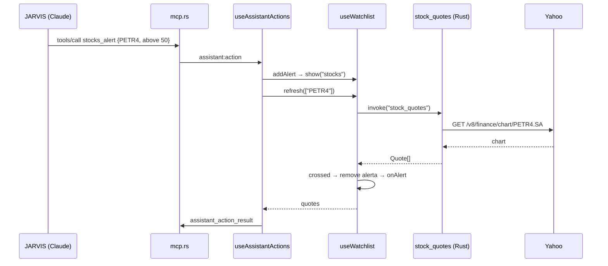

# Ações

Widget com as ações, FIIs, ETFs e índices que o usuário acompanha, com alertas de preço que o JARVIS também cria e que avisam mesmo com o widget fechado.

| | |
|---|---|
| **ID** | `widget/stocks` |
| **Status** | Implementado · não commitado |
| **Origem** | não commitado (27/10) |
| **Window kind** | `stocks` em `src/lib/desktop.ts` (380 × 300, mínimo 300 × 180, grupo `widgets`) |
| **Voz** | `window:stocks` ("ações", "cotações", "bolsa", "carteira de ações", "fundos imobiliários", "investimentos"); pedidos livres vão ao JARVIS, que usa as tools `stocks_*` |

## Visão geral

O widget Ações lista as ações, FIIs, ETFs e índices que o usuário acompanha. Para cada um ele mostra o preço, a variação do dia e uma minilinha com os preços de hoje, além dos alertas de preço pendentes. Os códigos entram digitados no widget ou pedidos ao JARVIS ("Jarvis, monitora a Petrobras"), que também consulta cotações e cria alertas de uso único. Quando um alerta dispara, há bipe, aviso no dock e fala do JARVIS, mesmo com o widget fechado. As cotações vêm do Yahoo Finance pelo Rust, sem chave de API, com cerca de 15 minutos de atraso na B3.

## Dados

- `$watchlist`: a **Watchlist**, `{ symbols[], alerts[] }`. Fica em `jarvis.watchlist`, gravada sem debounce (`delay = 0`) e sem migração. Ver [persistência](../../domain/persistence.md).
  - **RF-007**: O estado (códigos e alertas) DEVE ficar em `jarvis.watchlist` e sobreviver a recarregar.
  - **RF-001**: O widget DEVE acompanhar até 20 códigos (`MAX_WATCHED`), normalizados em maiúsculas e sem `.SA`.
    - `normalizeSymbol` aceita só `[A-Z0-9^.=-]` com 1 a 16 caracteres: `petr4` e `PETR4.SA` viram `PETR4`.
  - Cada **PriceAlert** é `{ id, symbol, above, below }`, com `above` e `below` em número ou `null`. É de uso único.
  - `parseWatch` normaliza e corta os códigos em 20, descarta alertas sem `id`/`symbol` ou sem nenhum limite e corta os alertas em 50.
- `$cotações`: a última **Quote** de cada código, só em memória: `symbol`, `name`, `price`, `change` (fração), `currency`, `time` (s epoch), `points[]`, `error`. Ver [glossário](../../domain/glossary.md).
- `$atualizado` e `$erro`: a hora da última atualização que deu certo e o erro da última consulta. Só em memória.

## Componentes

### `Stocks`

Mostra $watchlist com $cotações e o campo para adicionar um código.

- **Comportamento:**
  - O cabeçalho "Ações e FIIs" mostra `às HH:MM` de $atualizado. Se houver $erro, então mostra "sem conexão". Com códigos e ainda sem cotação, mostra "…".
  - Se $watchlist não tiver códigos, então mostre "Nenhum código ainda. Diga “Jarvis, monitora a Petrobras” ou digite abaixo."
  - **RF-002**: Cada linha DEVE mostrar código, minilinha (com 2 pontos ou mais), preço formatado (`R$`, `US$`, `€` ou a moeda), variação com sinal e duas casas, e os alertas pendentes.
    - O preço usa `formatPrice` (`R$ 53,88`) e a variação usa `formatChange` (`+1,52%`, `−8,18%`).
    - Enquanto o código não tiver cotação, o preço mostra "…".
    - Se só um código da lista vier com erro, então só ele mostra "erro", sem variação, e os outros seguem normais.
    - O nome completo do ativo (`name`) aparece como dica (tooltip) da linha.
    - Cada alerta pendente aparece sob a linha como "⚑ avisar acima de <preço>", "⚑ avisar abaixo de <preço>" ou os dois, ligados por "ou".
  - A minilinha (`Sparkline`) desenha os `points` do dia de ponta a ponta, com a escala entre o mínimo e o máximo. Com menos de 2 pontos, fica só o espaço vazio.
  - Quando o usuário clicar em "Parar de acompanhar <código>", tire o código e os alertas dele de $watchlist (`unwatch`).
  - Ao Enter no campo "Adicionar código" (placeholder `PETR4, HGLG11…`), acompanhe o código (`watch`), limpe o campo e cote só esse código (`refresh([código])`). Um texto vazio não é enviado.
    - Se o código for inválido (espaço, `/`, mais de 16 caracteres), então mostre "Código inválido: <texto>".
    - Se a lista já tiver 20 códigos, então mostre "A lista está cheia (20)".
  - Se a rede falhar ou o app não for o desktop, então $erro aparece embaixo da lista ("Disponível no app desktop" no modo web sem fake), e o cabeçalho diz "sem conexão".
- **Layout:**
  - Uma coluna com o `ReverseRow` "Ações e FIIs" no topo, a lista "Ações acompanhadas" no meio, que rola quando não cabe, e o formulário embaixo.
  - Cada linha tem o código à esquerda (7 caracteres), a minilinha (48 × 14), o preço alinhado à direita, a variação (8 caracteres, alinhada à direita) e o botão `X` de remover.
  - As linhas dos alertas ficam embaixo da linha do código, recuadas 8 caracteres.
  - A mensagem de erro fica entre a lista e o formulário.
  - O formulário tem o prompt `+` e o campo, separados da lista por uma borda.
- **Estilo:**
  - Tudo em `font-mono` 12 px, com o texto selecionável.
  - O código fica em `text-hud-cyan` e o preço em `text-hud-light`, com números tabulares. "erro" fica em `text-hud-alert/80`.
  - A variação negativa fica em `text-hud-alert`. As outras ficam em `text-hud-text/80`.
  - A minilinha tem traço de 1 px, em `stroke-hud-light/80`, ou `stroke-hud-alert/80` quando o dia está negativo.
  - O botão `X` (ícone de 11 px) fica invisível até o hover da linha ou o foco, em `text-hud-text/40`, e em `text-hud-alert` no hover.
  - Os alertas pendentes ficam em 10 px, `text-hud-amber/90`.
  - A mensagem de erro fica em 11 px, `text-hud-alert/85`. O texto da lista vazia fica em `text-hud-text/55`.
  - O formulário tem borda superior `hud-cyan/10` e o `+` em `text-hud-cyan`. O campo é transparente e escreve em maiúsculas, com o placeholder em caixa normal e `text-hud-text/30`.

### `useWatchlist`

O hook que guarda $watchlist, busca $cotações e checa os alertas. Ele vive no `App`, para os alertas funcionarem com o widget fechado.

- **Comportamento:**
  - `refresh(symbols?)` busca as cotações dos códigos pedidos, ou de todos, por `fetchQuotes`: o fake `__JARVIS_QUOTES__` em DEV ou o comando `stock_quotes`.
    - Junte as novas em $cotações, grave $atualizado e limpe $erro. Se a busca falhar, grave $erro.
  - **RF-004**: Um alerta DEVE disparar quando `price >= above` ou `price <= below`, em qualquer atualização, e então ser removido.
    - Um código com erro não dispara alerta (`crossed`).
    - Se o alerta tiver acima e abaixo, então ele dispara no primeiro limite cruzado.
    - Depois de remover os que dispararam, chame `onAlert` para cada um.
  - Com o widget aberto, busque ao abrir e depois a cada 60 s (`ACTIVE_MS`). Com o widget fechado e algum alerta pendente, busque a cada 120 s (`ALERTS_MS`), só para checar os alertas. Fechado e sem alerta, não busque nada.
  - Com o app escondido (`document.hidden`), o widget aberto não é visto: só os alertas seguem, no ritmo de 120 s. Na volta, cotações com mais de 60 s são buscadas na hora.
    - Se o widget fechar com alerta pendente, então a primeira checagem só acontece 120 s depois de fechar.
  - `watch(symbol)` devolve o código normalizado, ou `null` se ele não for um código ou se a lista estiver cheia.
  - `addAlert(symbol, above, below)` também acompanha o código. Ele exige pelo menos um limite, e cada limite maior que zero.
    - Se já houver 50 alertas, então novos alertas são recusados.
    - O novo alerta já vale no `refresh` seguinte, antes de o React renderizar.
  - `removeAlerts(symbol)` apaga todos os alertas do código.

### Disparo do alerta (`onAlert` no `App`)

- **Comportamento:**
  - **RF-005**: Ao disparar, o app DEVE tocar o bipe, pulsar o núcleo, mostrar "<código>: <preço>" no item Widgets do dock e fazer o JARVIS falar a linha `stockAlert`.
    - A fala é `stockAlertLine`, com o preço por extenso (`spokenPrice`), por exemplo "Alerta de preço, Tony: PETR4 a 53 reais e 88, acima de 50 reais.".

### Cotações no Rust (`feeds::quotes`)

- **Comportamento:**
  - **RF-003**: O Rust DEVE buscar até 20 códigos em paralelo em `query1.finance.yahoo.com/v8/finance/chart/<código>?range=1d&interval=15m` e devolver, na ordem pedida, uma `Quote` por código, com `error` preenchido quando aquele falhar.
    - Cada código roda numa thread (`std::thread::scope`). O comando nunca falha como um todo.
    - Os campos do chart que viram cada parte da `Quote` estão em [Yahoo Finance (Rust)](#yahoo-finance-rust).
  - Os códigos da B3 ganham o sufixo `.SA` para o Yahoo (`yahoo_symbol`): `petr4`, `PETR4.SA` e `HGLG11` viram `PETR4.SA`/`HGLG11.SA`, e voltam sem `.SA` para o usuário. `AAPL`, `^BVSP` e `BTC-USD` passam como estão.
  - `yahoo_symbol` só aceita `[A-Za-z0-9^.=-]` com até 16 caracteres antes de montar a URL, e recusa `PETR4/../x`.

### Tools `stocks_*` do JARVIS

- **Comportamento:**
  - **RF-006**: As tools `stocks_quote`, `stocks_watch` e `stocks_alert` DEVEM agir sobre o mesmo estado do widget. `stocks_watch` e `stocks_alert` abrem o widget.
  - `stocks_quote` cota `symbols` (até 20), ou os códigos do widget sem eles, e devolve `quotesReport`, uma linha por código. Um código inexistente vem como `<código>: erro (…)`.
    - Se não houver `symbols` e o widget estiver vazio, então responda `ok: false` ("Nenhum código pedido e o widget Ações está vazio").
  - `stocks_watch` põe `symbol` no widget, abre o widget e já cota o código. Com `remove: true`, tira o código.
    - Se o código for inválido ou a lista estiver cheia, então responda "Código inválido ou lista cheia (máximo 20)".
  - `stocks_alert` cria um alerta `above` e/ou `below` (aceita número ou texto com vírgula), abre o widget, avisa no dock "Alerta: PETR4 ≥ 50" e já checa o preço. Com `remove: true`, apaga os alertas do código.
    - Se não vier `above` nem `below`, ou se um deles for ≤ 0, então responda `ok: false`.

## Voz e teclado

- `window:stocks` ("ações", "cotações", "bolsa"…): abre ou fecha o widget.
- Fala livre ("Jarvis, monitora a Petrobras"): vai ao JARVIS, que chama `stocks_watch`.
- `Enter` no campo "Adicionar código": `watch()` + `refresh([código])`.

## Restrições

- **RNF-001**: As requisições saem do Rust com User-Agent de navegador e timeout de 10 s, porque o Yahoo responde "Too Many Requests" a clientes que não parecem navegador e a CSP da WebView bloqueia outras origens.
- **RNF-002**: Sem chave de API.
- **RNF-003**: Atualização a cada 60 s com o widget aberto, e a cada 120 s fechado só com alertas pendentes.
- ≤ 20 códigos, ≤ 16 caracteres cada; ≤ 50 alertas; timeout de 10 s; 60 s / 120 s de intervalo.

## Histórias de usuário

### US1 — Acompanhar códigos no widget (P1)

Como investidor, quero digitar "petr4" e ver o preço e a variação do dia.

**Por que P1:** é a função básica do widget.
**Teste independente:** `tests/feeds.spec.ts` — `stocks: typed into the widget or watched by JARVIS, with a price alert that goes off`.

**Aceite**

1. **Dado** o widget vazio, **então** vejo "Nenhum código ainda. Diga “Jarvis, monitora a Petrobras” ou digite abaixo."
2. **Dado** o campo "Adicionar código" (placeholder `PETR4, HGLG11…`), **quando** digito `petr4` e Enter, **então** aparece a linha `PETR4` com `R$ 53,88` e `−8,18%` (variação negativa na cor de alerta) e uma minilinha.
3. **Dado** cotações carregadas, **então** o cabeçalho "Ações e FIIs" mostra `às HH:MM` da última atualização. Sem conexão, mostra "sem conexão".
4. **Dado** uma linha, **quando** passo o mouse e clico em "Parar de acompanhar PETR4", **então** ela some de vez, junto com os alertas desse código.
5. **Dado** o nome completo do ativo, **então** ele aparece como dica (tooltip) da linha.

### US2 — Pedir ao JARVIS (P1)

Como usuário, quero dizer "Jarvis, monitora a Petrobras" (o exemplo do próprio widget) ou pedir uma cotação, e ter a resposta e o widget atualizados.

**Por que P1:** é o jeito principal de uso por voz.
**Teste independente:** `tests/feeds.spec.ts` — `stocks: typed into the widget or watched by JARVIS, with a price alert that goes off`.

**Aceite**

1. **Dado** a tool `stocks_watch { symbol: "hglg11" }`, **então** `HGLG11` entra no widget, que abre na tela, e o JARVIS recebe "HGLG11 no widget Ações. HGLG11 (FII CSHG LOG): R$ 151,70, +0,42% no dia, às HH:MM".
2. **Dado** `stocks_quote { symbols: ["PETR4", "NOPE3"] }`, **então** a resposta traz uma linha por código, e o inexistente vem como `NOPE3: erro (…)`.
3. **Dado** `stocks_quote` sem `symbols`, **então** são cotados os códigos do widget. Com o widget vazio, a tool responde erro.
4. **Dado** `stocks_watch { symbol, remove: true }`, **então** o código sai do widget.

### US3 — Alertas de preço (P2)

Como usuário, quero ser avisado quando um ativo passar de um preço ou cair abaixo dele.

**Por que P2:** é um valor extra sobre a lista, que funciona com o widget fechado.
**Teste independente:** `tests/feeds.spec.ts` — `stocks: typed into the widget or watched by JARVIS, with a price alert that goes off` e `JARVIS's lines for the weather, the agenda and a price alert`.

**Aceite**

1. **Dado** `stocks_alert { symbol: "HGLG11", below: 140 }` com o preço acima disso, **então** o alerta fica pendente e aparece sob a linha como "⚑ avisar abaixo de R$ 140,00".
2. **Dado** `stocks_alert { symbol: "PETR4", above: 50 }` com o preço já em 53,88, **então** o alerta dispara na hora: bipe, pulso do núcleo, dock "PETR4: R$ 53,88" e uma fala como "Alerta de preço, Tony: PETR4 a 53 reais e 88, acima de 50 reais."
3. **Dado** um alerta que disparou, **então** ele é apagado (uso único), e só os outros continuam em `jarvis.watchlist`.
4. **Dado** `stocks_alert` sem `above` nem `below` (ou com valor ≤ 0), **então** a tool responde `ok: false`.
5. **Dado** `stocks_alert { symbol, remove: true }`, **então** todos os alertas desse código são apagados.

### US4 — Atualização automática (P2)

**Aceite**

1. **Dado** o widget aberto, **então** as cotações são buscadas ao abrir e depois a cada 60 s.
2. **Dado** o widget fechado e algum alerta pendente, **então** as cotações são buscadas a cada 120 s, só para checar os alertas.
3. **Dado** o widget fechado e nenhum alerta, **então** nada é buscado.

## Critérios de sucesso

- **SC-001**: Um alerta cujo preço já foi cruzado é avisado logo depois de criado.
- **SC-002**: Um código com erro nunca impede os outros de aparecer.

## Fora de escopo e limitações

- Sem carteira (quantidade, preço médio, lucro), sem gráfico histórico além do dia e sem notícias.
- Dados com cerca de 15 minutos de atraso na B3 (Yahoo).
- Não há frase de voz própria além de abrir e fechar ("mostra as cotações"). "Monitora as ações da Petrobras" e "me avisa se a PETR4 passar de 60 reais" caem no JARVIS (fallback, ver [voice-commands](../../features/voice-commands/spec.md)), que converte o nome no código e chama a tool. Ver [assistant-tools](../../features/assistant-tools/spec.md).

## Código

`useWatchlist` vive no `App`, para que os alertas funcionem com o widget fechado. Ele guarda códigos e alertas em `jarvis.watchlist`, mantém as cotações em memória e decide quando atualizar: 60 s com o widget aberto, 120 s fechado só se houver alerta. `refresh` chama `fetchQuotes` (fake em DEV ou o comando `stock_quotes`), junta as cotações, procura alertas cruzados, remove os que dispararam e chama `onAlert`. No Rust, `feeds::quotes` busca cada código numa thread (`std::thread::scope`) pela API de chart do Yahoo, com `ureq`. As tools MCP `stocks_*` chegam por `assistant:action` e são executadas em `useAssistantActions` sobre o mesmo hook.

| | |
|---|---|
| **Camadas** | UI React (`Stocks.tsx`) · hook (`useWatchlist`) · lib (`feeds.ts`) · comando Tauri `stock_quotes` · módulo Rust `feeds.rs` · tools MCP |
| **Dependências** | Yahoo Finance (`/v8/finance/chart`, sem chave); crate `ureq` 3; `serde_json` |
| **Testes** | `tests/feeds.spec.ts`; Rust `mod tests` em `src-tauri/src/feeds.rs` |
| **Plataforma** | Windows 11 · WebView2; no modo web, fake `__JARVIS_QUOTES__` em DEV ou o erro "Disponível no app desktop" |

### Arquivos

| Arquivo | Papel |
|---|---|
| `src/components/desktop/widgets/Stocks.tsx` | lista, `Sparkline` (SVG 48 × 14), formulário "Adicionar código", alertas pendentes |
| `src/hooks/useWatchlist.ts` | estado, `parseWatch`, `crossed`, `refresh`, `watch`, `unwatch`, `addAlert`, `removeAlerts`, intervalos |
| `src/lib/feeds.ts` | `Quote`, `MAX_WATCHED`, `normalizeSymbol`, `fetchQuotes`, `formatPrice`, `formatChange`, `spokenPrice`, `spokenChange`, `quotesReport` |
| `src-tauri/src/feeds.rs` | `Quote`, `yahoo_symbol`, `parse_chart`, `quotes`, `get` (UA de navegador, 10 s) |
| `src-tauri/src/lib.rs` | `#[tauri::command] stock_quotes` |
| `src/hooks/useAssistantActions.ts` | `stocks_quote`, `stocks_watch`, `stocks_alert` |
| `src-tauri/src/mcp.rs` | declaração das três tools (nome, descrição, `inputSchema`) |
| `src/lib/jarvisLines.ts` | `stockAlert` e `stockAlertLine` |
| `src/App.tsx` | `useWatchlist({ active: widgetOpen("stocks"), onAlert })` |

### Contratos

#### Comandos Tauri

| Comando | Entrada | Saída | Notas |
|---|---|---|---|
| `stock_quotes` | `{ symbols: string[] }` | `Quote[]` | via `blocking()`; nunca falha como um todo, cada `Quote` traz o próprio `error` |

#### Ferramentas MCP (JARVIS)

| Tool | O que faz |
|---|---|
| `stocks_quote` | cotação de `symbols` (até 20) ou, sem eles, dos códigos do widget; devolve `quotesReport` |
| `stocks_watch` | põe `symbol` no widget (abre o widget e já cota), ou tira com `remove: true` |
| `stocks_alert` | cria alerta `above` e/ou `below` (aceita número ou texto com vírgula), abre o widget, avisa no dock "Alerta: PETR4 ≥ 50" e já checa o preço; `remove: true` apaga os alertas do código |

### Yahoo Finance (Rust)

| Campo do chart | Uso |
|---|---|
| `meta.regularMarketPrice` | `price` (sem ele: erro "sem preço") |
| `meta.regularMarketChangePercent` ou `price / chartPreviousClose − 1` | `change` |
| `meta.longName` / `shortName` (espaços normalizados) | `name` |
| `meta.currency` (padrão `BRL`), `meta.regularMarketTime` | `currency`, `time` |
| `indicators.quote[0].close` (sem nulos) | `points` |
| `chart.error.description` | erro "<código>: <descrição>" |

### Fluxo

### Constituição

- [x] P1 Offline-first: a rede só é usada para cotações, que são online por natureza. Sem chave de API.
- [x] P2 Rust é dono do nativo: o HTTP para o Yahoo sai do Rust, porque a CSP bloqueia outras origens na WebView.
- [x] P3 Comandos finos: `stock_quotes` em `lib.rs` só repassa para `feeds::quotes` via `blocking()`.
- [x] P4 Contratos espelhados: `Quote` em `feeds.ts` traz `Mirrors \`Quote\` in src-tauri/src/feeds.rs`, e o Rust usa `rename_all = "camelCase"`.
- [x] P5 Persistência tolerante: `parseWatch` normaliza e corta os códigos em 20, descarta alertas sem `id`/`symbol` ou sem limite e corta em 50.
- [x] P6 Funciona fora do Tauri: caminhos 2 (`__JARVIS_QUOTES__` em DEV) e 3 ("Disponível no app desktop").
- [x] P7 PT-BR: textos do widget, erros do Rust ("Código inválido", "sem preço", "Sem resposta de …"), respostas das tools e fala do alerta.
- [x] P8 Linguagem visual: `ReverseRow`, minilinha em `stroke-hud-light`/`stroke-hud-alert`, alertas em `hud-amber`.
- [x] P9 Desktop leve: com o widget fechado, o poll só existe se houver alerta, como manda a exceção. Com o app oculto, o de 60 s cai para o ritmo dos alertas (2026-11-04).
- [x] P10 Segurança: `yahoo_symbol` só aceita `[A-Za-z0-9^.=-]` com até 16 caracteres antes de montar a URL, e recusa `PETR4/../x`.
- [x] P11 Coberto por teste: E2E (widget, tools, alerta) e Rust (sufixo B3, parse do chart). A chamada real fica em `#[ignore]`.

### Decisões relacionadas

- [ADR-0001 — Tauri 2 + Rust](../../arch/adr/0001-tauri-rust-desktop.md)
- [ADR-0006 — JARVIS via Claude CLI](../../arch/adr/0006-jarvis-via-claude-cli.md)
- [ADR-0008 — MCP HTTP in-process](../../arch/adr/0008-mcp-http-in-process.md)
- [ADR-0009 — tipos espelhados TS ↔ Rust](../../arch/adr/0009-tipos-espelhados-ts-rust.md)
- [ADR-0011 — fakes de dev e E2E no modo web](../../arch/adr/0011-fakes-de-dev-e-e2e-modo-web.md)

## Tarefas

Legenda: `[x]` feito · `[ ]` pendente · `[P]` pode rodar em paralelo (arquivos diferentes) · `[USn]` história desta spec. As tarefas foram reconstruídas do código e do commit de origem.

### Fase 1 — Base

- [x] T001 Rust: `Quote`, `get` com `ureq` (UA de navegador, 10 s), `yahoo_symbol` com sufixo `.SA` para a B3 — `src-tauri/src/feeds.rs`
- [x] T002 Rust: `parse_chart` (preço, variação, nome, moeda, pontos) e `quotes` em paralelo, até 20 — `src-tauri/src/feeds.rs`
- [x] T003 Comando `stock_quotes` via `blocking()` — `src-tauri/src/lib.rs`
- [x] T004 [P] TS: `Quote` espelhado, `normalizeSymbol`, `fetchQuotes` com fake `__JARVIS_QUOTES__`, formatadores de preço e variação — `src/lib/feeds.ts`
- [x] T005 [P] `stocks` em `WINDOW_SPECS` (380 × 300, mín. 300 × 180), palavras de busca e `window:stocks` — `src/lib/desktop.ts`, `src/lib/commands.ts`, `src-tauri/voice-commands.json`

### Fase 2 — US1 Acompanhar códigos no widget (P1)

- [x] T006 [US1] `useWatchlist`: `jarvis.watchlist`, `parseWatch`, `watch`, `unwatch`, `refresh` — `src/hooks/useWatchlist.ts`
- [x] T007 [US1] Widget: cabeçalho com hora ou "sem conexão", linhas com `Sparkline`, preço, variação e remoção, e formulário "Adicionar código" — `src/components/desktop/widgets/Stocks.tsx`
- [x] T008 [US1] `useWatchlist` no `App`, com `active: widgetOpen("stocks")` — `src/App.tsx`

### Fase 3 — US2 Pedir ao JARVIS (P1)

- [x] T009 [US2] [P] Declarar `stocks_quote`, `stocks_watch` e `stocks_alert` em `TOOLS` e `tools()` — `src-tauri/src/mcp.rs`
- [x] T010 [US2] Executar as três tools sobre o hook, com `quotesReport` — `src/hooks/useAssistantActions.ts`, `src/lib/feeds.ts`

### Fase 4 — US3 Alertas de preço (P2)

- [x] T011 [US3] `addAlert` (valida, ≤ 50, visível já no `refresh` seguinte), `removeAlerts` e `crossed` — `src/hooks/useWatchlist.ts`
- [x] T012 [US3] Disparo de uso único em `refresh`; `onAlert` no `App` com bipe, pulso, dock e fala — `src/hooks/useWatchlist.ts`, `src/App.tsx`
- [x] T013 [US3] [P] Fala `stockAlert`, `stockAlertLine`, `spokenPrice` — `src/lib/jarvisLines.ts`, `src/lib/feeds.ts`

### Fase 5 — US4 Atualização automática (P2)

- [x] T014 [US4] Intervalos `ACTIVE_MS` (60 s) e `ALERTS_MS` (120 s, só com alertas) — `src/hooks/useWatchlist.ts`

### Fase 6 — Testes

- [x] T015 Playwright `tests/feeds.spec.ts` — "tickers, prices and the weather in words"
- [x] T016 Playwright `tests/feeds.spec.ts` — "JARVIS's lines for the weather, the agenda and a price alert"
- [x] T017 Playwright `tests/feeds.spec.ts` — "stocks: typed into the widget or watched by JARVIS, with a price alert that goes off"
- [x] T018 [P] Rust `src-tauri/src/feeds.rs` — `b3_tickers_get_the_exchange_suffix`
- [x] T019 [P] Rust `src-tauri/src/feeds.rs` — `a_chart_gives_the_price_the_change_and_the_day`
- [x] T020 [P] Rust `src-tauri/src/feeds.rs` — `feeds_answer_for_real` (`#[ignore]`, rede real)
- [x] T021 [P] Rust `src-tauri/src/voice/matcher.rs` — `the_weather_the_agenda_and_the_stocks_by_voice` ("Monitora as ações da Petrobras" e "me avisa se a PETR4 passar de 60 reais" vão ao JARVIS; "mostra as cotações" abre o widget)

## Pendências

- [x] ~~O poll de 60 s continua com o widget aberto e o app oculto ou minimizado (P9).~~ Oculto, só os alertas seguem, a cada 120 s; na volta, cotações velhas são buscadas na hora — `src/hooks/useWatchlist.ts` (2026-11-04)
- [ ] `feeds_answer_for_real` usa `#[ignore]` sem o motivo (`#[ignore = "…"]`) que a P11 pede — `src-tauri/src/feeds.rs`
