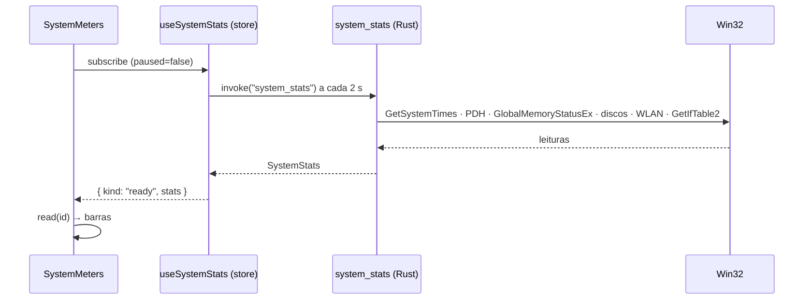

# Sistema

Widget monitor de recursos no estilo Rainmeter, com uma barra fina por medidor, lido do Windows pelo Rust.

| | |
|---|---|
| **ID** | `widget/system` |
| **Status** | Implementado |
| **Origem** | `c4ccc57` (2026-10-26) |
| **Window kind** | `system` em `src/lib/desktop.ts` (300 × 290, mínimo 220 × 110, grupo `widgets`) |
| **Voz** | `window:system` ("sistema", "monitor do sistema", "desempenho", "uso do sistema") |

## Visão geral

O widget Sistema é um monitor de recursos no estilo Rainmeter: uma barra fina por medidor (CPU, GPU, HDD, WLAN, RAM e memória virtual), cada uma com o nome sublinhado, um detalhe esmaecido e a porcentagem, que muda para a cor de alerta quando o recurso aperta. O botão direito escolhe as barras, os detalhes e qual disco o HDD mostra. As leituras vêm do Windows por um comando Rust (`system_stats`), lido a cada 2 s por um único poll compartilhado com a barra de menu do [jv_ide](../../apps/jv_ide/spec.md). O mesmo comando alimenta o status falado pelo JARVIS ([voice-shortcuts](../../features/voice-shortcuts/spec.md)).

## Dados

- `$leitura`: o estado do store, `loading` · `unavailable` · `ready { stats }`. Só em memória, compartilhado por todos os assinantes.
  - `stats` é o **SystemStats**: `cpu`, `gpu`, `ram`, `memory`, `disks[]`, `wlan`, `net`. Um medidor que a máquina não informa vem `null`. Ver [glossário](../../domain/glossary.md) e [contrato IPC](../../arch/ipc-contract.md).
  - **Usage**: `{ used, total }` em bytes. **DiskUsage**: `Usage` + `name` (`"C:"`).
- `$prefs`: as **Preferências dos medidores**, `{ bars, disk, details }`. Padrão: todas as barras, `disk: "C:"` e `details: true`. Ficam em `jarvis.meters` (250 ms; sem migração). Ver [persistência](../../domain/persistence.md).
  - **RF-005**: O widget DEVE guardar as barras, o disco (`^[A-Z]:$`) e os detalhes em `jarvis.meters`.
  - `parseMeters` descarta ids desconhecidos e põe `bars` na ordem fixa, troca um disco fora de `^[A-Z]:$` por `C:` e usa o padrão para um `details` que não seja booleano.

## Componentes

### Leitura no Rust (`system::Sampler`)

Um `Sampler` único no `AppState`, atrás de um `Mutex`, que guarda o que as taxas comparam (tempos de CPU, a query PDH da GPU, contadores de rede) e o handle do WLAN.

- **Comportamento:**
  - **RF-001**: O Rust DEVE ler, a cada chamada de `system_stats`: CPU ocupada desde a leitura anterior, uso do motor 3D da GPU, RAM física, memória comprometida contra o limite, espaço de cada disco fixo, o sinal e o SSID do Wi-Fi conectado, e a vazão da rede.
    - A fonte de cada medidor está em [Como cada medidor é lido (Rust)](#como-cada-medidor-é-lido-rust).
  - Se não houver GPU, ou se os contadores PDH estiverem desligados, então `gpu` vem `None`. Se nenhum motor 3D estiver em uso, então a leitura é 0%.
  - Se a máquina não tiver Wi-Fi (sem o serviço WLAN), então `wlan` vem `None`, e o handle é tentado de novo a cada 60 s (antes, a cada leitura).
  - A lista de discos é relida a cada 30 s: o espaço livre quase não muda entre duas leituras com 2 s de intervalo.
  - A vazão da rede vem `None` na primeira leitura.
  - Se não estiver no Windows, então o `Sampler` devolve todos os medidores vazios (`SystemStats::default()`).

### `useSystemStats` (store)

O store externo (`useSyncExternalStore`) que faz um único poll para todas as telas que mostram os medidores.

- **Comportamento:**
  - **RF-002**: A UI DEVE fazer um único poll de 2 s para todos os assinantes, que para quando o último sai ou pausa.
    - O primeiro assinante lê na hora e liga o `setInterval` de 2 s (`POLL_MS`). Quando o último sai, o intervalo para.
    - Se o widget e a barra do jv_ide estiverem na tela ao mesmo tempo, então há um poll só.
  - Se o app estiver oculto ou minimizado (`paused`), então o assinante sai do poll e a última leitura fica na tela.
  - **RF-006**: No modo de desenvolvimento, `window.__JARVIS_SYSTEM__` DEVE substituir o comando Rust.
  - Fora do Tauri e sem o fake, publique `unavailable`.
  - Se o comando falhar, então $leitura vira `unavailable` até a próxima leitura bem-sucedida.

### `SystemMeters`

O widget: transforma cada medidor numa leitura (rótulo, nome acessível, valor 0..1, detalhe, alerta) e mostra as barras de $prefs.

- **Comportamento:**
  - **RF-003**: O widget DEVE mostrar as barras escolhidas na ordem fixa `cpu`, `gpu`, `disk`, `wlan`, `ram`, `memory`.
    - Os nomes acessíveis das barras são "Uso da CPU", "Uso da GPU", "Espaço usado em <drive>", "Sinal do Wi-Fi", "Uso da RAM" e "Memória virtual em uso".
    - Os rótulos são "CPU", "GPU", "HDD <drive>", "WLAN", "RAM" e "Memória".
  - Os detalhes são `N núcleos` (CPU, de `navigator.hardwareConcurrency`), `motor 3D` ou `sem contadores` (GPU), `<usado> / <total> GB` (HDD e RAM), o SSID ou `desconectado` (WLAN) e `virtual · <usado> / <total> GB` (memória).
    - Os GB levam até uma casa decimal, ou nenhuma quando o total é de 100 GB ou mais.
    - Sem leitura, a RAM e a memória dizem `indisponível` e o HDD diz `nenhum disco`.
  - **RF-004**: O widget DEVE alertar a partir de 0,9 de uso (`HIGH`), e no Wi-Fi a partir de 0,25 de sinal para baixo (`WEAK_SIGNAL`).
  - Se o disco escolhido sumir (pendrive, drive desmontado), então o HDD mostra o primeiro disco fixo (`shownDisk`).
  - Se a GPU não tiver contadores, então ela fica `--` com "sem contadores". Se a máquina não tiver Wi-Fi, então WLAN fica `--` e "desconectado".
  - Enquanto $leitura for `loading`, mostre `$ Lendo o sistema…`. Se for `unavailable`, mostre `$ Indisponível neste ambiente`.
  - Se nenhuma barra estiver escolhida, então mostre "Nenhuma barra · botão direito para escolher".
- **Layout:**
  - O widget rola na vertical quando as barras não cabem (`overflow-y-auto px-4 py-3`) e recebe foco (`tabIndex={0}`) para abrir o menu pelo teclado.
  - As linhas `MeterRow` ficam numa coluna centralizada na vertical, com `gap-3` entre elas.
  - As mensagens (`$ …` e "Nenhuma barra…") ficam numa linha centralizada na vertical.
- **Estilo:**
  - Tudo em `font-mono`, com o texto selecionável.
  - O foco desenha um anel interno fino (`ring-1`, `hud-light/40`).
  - As mensagens ficam em 12 px, `text-hud-text/55`, com o `$` em `text-hud-cyan`.

### `MeterRow`

Uma barra: o nome, o detalhe, a porcentagem e a barra fina embaixo.

- **Comportamento:**
  - A porcentagem é o valor arredondado, ou `--` quando o medidor vem `null`. Nesse caso a barra fica vazia.
  - Se a leitura estiver em alerta, então a porcentagem e a barra ficam na cor de alerta.
  - Se `details` estiver desligado em $prefs, então o detalhe some e a barra fica.
  - A largura da barra anima em 700 ms a cada leitura.
- **Layout:**
  - Em cima, uma linha com o rótulo à esquerda, o detalhe ocupando o meio e a porcentagem à direita.
  - Embaixo, a barra (`role="progressbar"`, com o nome acessível da leitura).
- **Estilo:**
  - A linha de cima fica em 12 px. O rótulo fica em maiúsculas, `tracking-[0.16em]`, `text-hud-text`, sublinhado (`decoration-hud-text/40`, `underline-offset-4`).
  - O detalhe fica em 11 px, `text-hud-text/45`, cortado com reticências.
  - A porcentagem usa números tabulares, `text-hud-light`, ou `text-hud-alert` no alerta.
  - A barra tem 3 px de altura, com o trilho em `bg-hud-text/12`. O preenchimento é `bg-hud-light` com brilho `hud-holo`, ou `bg-hud-alert` com brilho `hud-alert`, os dois por `color-mix` a 80% numa sombra de 6 px. A largura anima com `transition-[width] duration-700 ease-out`.

### Menu "Opções do widget Sistema"

O menu de botão direito, feito com `useWidgetMenu` e `WidgetMenu`, mas sem `useWidgetOptions`.

- **Comportamento:**
  - Marcar ou desmarcar uma barra deixa o menu aberto e grava $prefs, sempre na ordem fixa das barras.
  - "Detalhes" liga e desliga os textos esmaecidos.
  - Um rádio de "Disco do HDD" troca o disco do HDD.
  - `Esc` ou um clique fora fecham o menu.
- **Layout:**
  - A seção "Barras", com seis caixas: "CPU", "GPU", "HDD", "WLAN", "RAM" e "Memória".
  - A seção "Exibir", com a caixa "Detalhes".
  - Se houver mais de um disco fixo, então aparece a seção "Disco do HDD", com um rádio por drive e o tamanho (`<usado> / <total> GB`) à direita.
- **Estilo:** o kit do `WidgetMenu`: `font-mono` 12 px, borda `hud-cyan/30`, fundo `hud-panel/95`, separador `hud-cyan/20` entre as seções. As caixas são `[x]` / `[ ]` e os rádios `(•)` / `( )`, em `text-hud-cyan`. O tamanho do disco fica em 10 px, esmaecido.

## Voz e teclado

- `window:system` ("sistema", "monitor do sistema", "desempenho", "uso do sistema"): abre ou fecha o widget.
- Botão direito / tecla de menu: menu "Opções do widget Sistema".

## Restrições

- **RNF-001**: As leituras usam Win32 por FFI direta (kernel32, pdh, wlanapi, iphlpapi), sem crates extras.
- **RNF-002**: A leitura roda fora da thread principal (`spawn_blocking`), sobre um `Sampler` único guardado no `AppState`.
- **RNF-003**: As taxas (CPU, GPU, rede) cobrem o intervalo desde a leitura anterior. A rede é `None` na primeira.
- Poll de 2 s (`POLL_MS`); alerta ≥ 0,9; Wi-Fi fraco ≤ 0,25.

## Histórias de usuário

### US1 — Ver o uso da máquina num relance (P1)

Como usuário, quero ver CPU, GPU, disco, Wi-Fi, RAM e memória virtual atualizando sozinhos.

**Por que P1:** é a função do widget.
**Teste independente:** `tests/meters.spec.ts` — `one widget holds every bar; right click picks the bars and the HDD's drive`.

**Aceite**

1. **Dado** o app desktop, **quando** abro "Sistema", **então** vejo seis barras, nesta ordem: "Uso da CPU", "Uso da GPU", "Espaço usado em C:", "Sinal do Wi-Fi", "Uso da RAM" e "Memória virtual em uso".
2. **Dado** as leituras, **então** cada linha mostra o detalhe: `N núcleos` (CPU), `motor 3D` ou `sem contadores` (GPU), `228 / 476 GB` (HDD), o SSID ou `desconectado` (WLAN), `17,2 / 31,8 GB` (RAM) e `virtual · 41 / 45 GB` (memória).
3. **Dado** um uso de 90% ou mais (ou um sinal de Wi-Fi de 25% ou menos), **então** a porcentagem e a barra ficam na cor de alerta.
4. **Dado** o widget aberto, **então** os valores se renovam a cada 2 s, e a barra anima a largura em 700 ms.

### US2 — Escolher barras, detalhes e disco (P2)

Como usuário, quero mostrar só o que me interessa e escolher qual drive o HDD acompanha.

**Por que P2:** adapta o monitor a cada máquina.
**Teste independente:** `tests/meters.spec.ts` — `one widget holds every bar; right click picks the bars and the HDD's drive`.

**Aceite**

1. **Dado** o widget, **quando** clico com o botão direito, **então** abre "Opções do widget Sistema" com a seção "Barras" (seis caixas: CPU, GPU, HDD, WLAN, RAM, Memória), a seção "Exibir" ("Detalhes") e, se houver mais de um disco fixo, "Disco do HDD", com um rádio por drive e o tamanho ao lado.
2. **Dado** o menu aberto, **quando** desmarco GPU e Memória, **então** o menu continua aberto e sobram quatro barras.
3. **Dado** "Detalhes" desmarcado, **então** os textos esmaecidos somem e as barras ficam.
4. **Dado** o rádio `D:`, **quando** escolho, **então** a barra vira "Espaço usado em D:".
5. **Dado** essas escolhas, **quando** fecho o menu (Esc ou clique fora) e recarrego, **então** `jarvis.meters` guarda `{ bars: ["cpu","disk","wlan","ram"], disk: "D:", details: true }` e o widget volta igual.
6. **Dado** todas as barras desmarcadas, **então** o widget diz "Nenhuma barra · botão direito para escolher".

### US3 — Fora do app desktop (P2)

**Teste independente:** `tests/meters.spec.ts` — `the monitor is in the widgets launcher, and says so outside the desktop app`.

**Aceite**

1. **Dado** o modo web sem o fake `__JARVIS_SYSTEM__`, **quando** abro "Sistema" pelo lançador de Widgets, **então** o widget mostra `$ Indisponível neste ambiente`.
2. **Dado** a primeira leitura ainda em andamento, **então** mostra `$ Lendo o sistema…`.

## Critérios de sucesso

- **SC-001**: Os números do widget ficam próximos dos do Gerenciador de Tarefas nos mesmos instantes.
  > ⚠ inferido — confirmar: o código só afirma isso para a GPU ("their sum is what Task Manager shows").
- **SC-002**: Com o app oculto, nenhuma leitura é feita.

## Fora de escopo e limitações

- A vazão da rede (`net`) é lida, mas o widget não a mostra. Quem usa é o jv_ide.
- Não há histórico nem gráfico no tempo, só o valor atual.
- O widget não usa `useWidgetOptions`: as preferências ficam em `jarvis.meters`, com parser próprio.

## Código

O Rust mantém um `system::Sampler` no `AppState`, atrás de um `Mutex`. Ele guarda o que as taxas comparam (tempos de CPU, a query PDH da GPU, contadores de rede) e o handle do WLAN. O comando `system_stats` lê tudo de uma vez em `spawn_blocking`. Na UI, `useSystemStats` é um store externo (`useSyncExternalStore`) com um único `setInterval` de 2 s para todos os assinantes: o widget e a barra de menu do jv_ide. O widget transforma cada medidor em uma `Reading` (rótulo, nome acessível, valor 0..1, detalhe, alerta) e guarda as escolhas em `jarvis.meters`.

| | |
|---|---|
| **Camadas** | UI React (`SystemMeters.tsx`) · hook/store (`useSystemStats`) · comando Tauri `system_stats` · módulo Rust `system.rs` |
| **Dependências** | Win32 por FFI: `GetSystemTimes`, `GlobalMemoryStatusEx`, `GetLogicalDrives`/`GetDriveTypeW`/`GetDiskFreeSpaceExW`, PDH (`\GPU Engine(*engtype_3D)\Utilization Percentage`), `wlanapi`, `GetIfTable2` |
| **Testes** | `tests/meters.spec.ts`; Rust `mod tests` em `src-tauri/src/system.rs` |
| **Plataforma** | Windows 11 · WebView2; fora do Windows o `Sampler` devolve `SystemStats::default()`; no modo web, fake `__JARVIS_SYSTEM__` ou "Indisponível neste ambiente" |

### Arquivos

| Arquivo | Papel |
|---|---|
| `src-tauri/src/system.rs` | `SystemStats`, `Usage`, `Disk`, `Wlan`, `Net`; `busy_share`, `throughput`; módulo `win` com FFI e `Sampler` |
| `src-tauri/src/lib.rs` | `#[tauri::command] system_stats`; `AppState.system: Arc<Mutex<system::Sampler>>` |
| `src/hooks/useSystemStats.ts` | tipos TS, `poll`, `subscribe`, `useSystemStats(paused)` |
| `src/components/desktop/widgets/SystemMeters.tsx` | `METERS`, `parseMeters`, `read`, `MeterRow`, menu "Barras" / "Exibir" / "Disco do HDD" |
| `src/components/desktop/apps/ide/MenuBar.tsx` | outro assinante do mesmo poll (rede, CPU, RAM) |
| `src/App.tsx` | `readMachine()` chama `system_stats` (ou o fake) para o status do JARVIS |

### Contratos

#### Comandos Tauri

| Comando | Entrada | Saída | Notas |
|---|---|---|---|
| `system_stats` | — | `SystemStats` | `spawn_blocking`; as taxas cobrem o tempo desde a chamada anterior |

`SystemStats` = `{ cpu: number|null, gpu: number|null, ram: Usage|null, memory: Usage|null, disks: { name, used, total }[], wlan: { signal, ssid }|null, net: { down, up }|null }`. `Disk` achata `usage` com `#[serde(flatten)]`.

### Como cada medidor é lido (Rust)

| Medidor | Fonte | Observação |
|---|---|---|
| CPU | `GetSystemTimes` (idle vs. kernel + user) | `busy_share` entre duas leituras |
| GPU | PDH, soma de todos os motores 3D | soma ÷ 100, limitada a 0..1 |
| RAM / memória | `GlobalMemoryStatusEx` | memória = commit contra o limite de commit |
| Discos | drives `DRIVE_FIXED` de A: a Z: | `used = total − free` |
| WLAN | primeira interface conectada (`wlanapi`) | qualidade ÷ 100; SSID em UTF-8 |
| Rede | `GetIfTable2`, só interfaces físicas, ativas e que não são filtro | bytes/s; interface nova ou contador zerado contam 0 |

### Fluxo

### Constituição

- [x] P1 Offline-first: só lê a máquina local.
- [x] P2 Rust é dono do nativo: todas as leituras passam por `system_stats`.
- [x] P3 Comandos finos: `system_stats` em `lib.rs` só repassa para `system::Sampler::read`. Usa `tauri::async_runtime::spawn_blocking` direto, não o helper `blocking()`, porque `read()` não devolve `Result`.
- [ ] P4 Contratos espelhados: parcial. `SystemStats`, `Usage` e `DiskUsage` em `useSystemStats.ts` espelham `system.rs`, mas o TS não traz o comentário `Mirrors`. Os campos são de uma palavra só, então a falta de `rename_all` não muda nada.
- [x] P5 Persistência tolerante: `parseMeters` filtra ids desconhecidos, valida o disco com `^[A-Z]:$` e usa o padrão para `details`.
- [x] P6 Funciona fora do Tauri: caminhos 2 (`__JARVIS_SYSTEM__` em DEV) e 3 ("Indisponível neste ambiente").
- [x] P7 PT-BR: rótulos ("Uso da CPU", "Sinal do Wi-Fi", "Memória virtual em uso"), detalhes e menu.
- [x] P8 Linguagem visual: barras de 3 px com brilho `hud-holo`/`hud-alert` via `color-mix`.
- [x] P9 Desktop leve: um poll para todos, que para com `paused` ou quando o último assinante sai.
- [x] P11 Coberto por teste: E2E com o fake, e Rust para `busy_share`, `throughput` e a leitura real.

### Decisões relacionadas

- [ADR-0001 — Tauri 2 + Rust](../../arch/adr/0001-tauri-rust-desktop.md)
- [ADR-0009 — tipos espelhados TS ↔ Rust](../../arch/adr/0009-tipos-espelhados-ts-rust.md)
- [ADR-0011 — fakes de dev e E2E no modo web](../../arch/adr/0011-fakes-de-dev-e-e2e-modo-web.md)
- [ADR-0014 — linguagem visual TUI](../../arch/adr/0014-linguagem-visual-tui.md)

## Tarefas

Legenda: `[x]` feito · `[ ]` pendente · `[P]` pode rodar em paralelo (arquivos diferentes) · `[USn]` história desta spec. As tarefas foram reconstruídas do código e do commit de origem.

### Fase 1 — Base (Rust)

- [x] T001 Tipos `SystemStats`, `Usage`, `Disk` (`flatten`), `Wlan` e `Net` — `src-tauri/src/system.rs`
- [x] T002 `busy_share` e `throughput` puros, testáveis fora do Windows — `src-tauri/src/system.rs`
- [x] T003 FFI Win32: `cpu_times`, `memory`, `disks`, `Gpu` (PDH), `wlan`, `net_counters` — `src-tauri/src/system.rs`
- [x] T004 `Sampler` com estado entre leituras e reabertura do WLAN; stub fora do Windows — `src-tauri/src/system.rs`
- [x] T005 Comando `system_stats` e `AppState.system` — `src-tauri/src/lib.rs`

### Fase 2 — US1 Ver o uso da máquina (P1)

- [x] T006 [US1] Store `useSystemStats`: um poll de 2 s, fake `__JARVIS_SYSTEM__`, `unavailable` fora do Tauri — `src/hooks/useSystemStats.ts`
- [x] T007 [US1] `read()` por medidor (rótulo, nome acessível, detalhe, alerta) e `MeterRow` com barra de 3 px — `src/components/desktop/widgets/SystemMeters.tsx`
- [x] T008 [US1] [P] `system` em `WINDOW_SPECS` (300 × 290, mín. 220 × 110), palavras de busca e `window:system` — `src/lib/desktop.ts`, `src/lib/commands.ts`, `src-tauri/voice-commands.json`

### Fase 3 — US2 Barras, detalhes e disco (P2)

- [x] T009 [US2] `jarvis.meters` com `parseMeters` e ordem fixa das barras — `src/components/desktop/widgets/SystemMeters.tsx`
- [x] T010 [US2] Menu com "Barras" (checks), "Exibir" ("Detalhes") e "Disco do HDD" (rádios, só com mais de um disco) — `src/components/desktop/widgets/SystemMeters.tsx`
- [x] T011 [US2] Disco escolhido ausente cai no primeiro (`shownDisk`) — `src/components/desktop/widgets/SystemMeters.tsx`

### Fase 4 — US3 Fora do app desktop (P2)

- [x] T012 [US3] Mensagens `$ Lendo o sistema…` e `$ Indisponível neste ambiente` — `src/components/desktop/widgets/SystemMeters.tsx`

### Fase 5 — Testes

- [x] T013 Playwright `tests/meters.spec.ts` — "one widget holds every bar; right click picks the bars and the HDD's drive"
- [x] T014 Playwright `tests/meters.spec.ts` — "the monitor is in the widgets launcher, and says so outside the desktop app"
- [x] T015 [P] Rust `src-tauri/src/system.rs` — `busy_share_is_the_non_idle_part_of_the_elapsed_time`
- [x] T016 [P] Rust `src-tauri/src/system.rs` — `throughput_counts_what_moved_per_second`
- [x] T017 [P] Rust `src-tauri/src/system.rs` — `reads_this_machine` (só no Windows)

## Pendências

- [ ] `reads_this_machine` depende da máquina (exige o drive `C:` e contadores reais), mas não leva `#[ignore = "motivo"]`, como a P11 pede — `src-tauri/src/system.rs`
- [ ] Os tipos TS em `src/hooks/useSystemStats.ts` não trazem o comentário `Mirrors \`SystemStats\` in src-tauri/src/system.rs` (P4).
