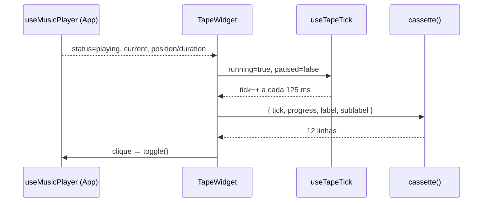

# Widget: Fita

Widget decorativo do jv_T4p3: a fita cassete desenhada em texto, girando enquanto a música toca.

| | |
|---|---|
| **ID** | `widget/tape` |
| **Status** | Implementado |
| **Origem** | `42e671a` (2026-10-23) · evoluída em `c4ccc57` |
| **Window kind** | `tape` em `src/lib/desktop.ts` (380 × 250, mínimo 260 × 180, grupo `widgets`) |
| **Voz** | `window:tape` ("fita", "cassete", "fita cassete") |

## Objetivo

A Fita é o widget decorativo do jv_T4p3: só a fita cassete desenhada em texto, girando enquanto a música toca. A etiqueta traz o nome da playlist e "Título — Artista", e os carretéis passam a fita da esquerda para a direita conforme a música avança. Um clique, ou Espaço, toca ou pausa. As teclas `n` e `b` pulam faixas. O widget não toca nada sozinho: segue o player do app inteiro, descrito em [jv_T4p3](../../apps/jv_t4p3/spec.md), que continua tocando com o player fechado.

## Não-objetivos

- O widget não escolhe playlist nem busca música. Isso é do [jv_T4p3](../../apps/jv_t4p3/spec.md).
- A barra de progresso clicável fica no Mini player. A fita só mostra o avanço nos rolos.

## Histórias de usuário

### US1 — Ver a fita acompanhar a música (P1)

Como usuário, quero um cassete na tela que gire com a música e mostre o que está tocando.

**Por que P1:** é o propósito do widget.
**Teste independente:** `tests/music.spec.ts` — `the Fita and Mini player widgets follow the music, which goes on with the player closed`.

**Aceite:** [critérios 1 a 4, 9 e 10](#critérios-de-aceite).

### US2 — Controlar a música pela fita (P2)

Como usuário, quero tocar, pausar e pular sem abrir o player.

**Por que P2:** é um controle rápido, mas o mini player faz o mesmo e mais.
**Teste independente:** `tests/music.spec.ts` — `the Fita and Mini player widgets follow the music, which goes on with the player closed`.

**Aceite:** [critérios 5 a 6](#critérios-de-aceite).

### US3 — Abrir pela voz e escolher a etiqueta (P3)

**Teste independente:** `tests/music.spec.ts` — `voice plays playlists, skips, pauses and opens or closes the player and its widgets`; `tests/widgets.spec.ts` — `Fita: right click turns parts of the widget off, and it stays so`.

**Aceite:** [critérios 7 a 8](#critérios-de-aceite).

## Critérios de aceite

### Critério 1 (US1)

- **Dado** uma música tocando com o jv_T4p3 fechado
- **Quando** abro "Fita" no lançador de Widgets
- **Então** a etiqueta mostra o nome da playlist em maiúsculas (ex.: `FLASH FM`) com `LADO A C90` à direita.

### Critério 2 (US1)

- **Dado** a fita tocando
- **Então** os dentes dos carretéis giram um passo a cada 125 ms e a fita entre as cabeças se move.

### Critério 3 (US1)

- **Dado** a música avançando
- **Então** o rolo da esquerda diminui e o da direita cresce (de 1 a 5 blocos `▓` cada).

### Critério 4 (US1)

- **Dado** a música pausada (pela barra superior ou pelo mini player)
- **Então** a fita para e o desenho fica em tom esmaecido.

### Critério 5 (US2)

- **Dado** a música pausada
- **Quando** clico no cassete ("Tocar a música")
- **Então** ela volta a tocar. Com ela tocando, o mesmo clique ("Pausar a música") pausa.

### Critério 6 (US2)

- **Dado** o widget em foco
- **Quando** aperto Espaço, `n` ou `b`
- **Então** a música toca/pausa, avança ou volta. `-` e `+` (ou `=`) mudam o volume em 5%.

### Critério 7 (US3)

- **Dado** o motor de voz
- **Quando** digo "abre a fita" e depois "fecha a fita"
- **Então** o widget abre e fecha.

### Critério 8 (US3)

- **Dado** o menu "Opções do widget Fita" (seção "Etiqueta")
- **Quando** desmarco "Nome da playlist"
- **Então** a primeira linha da etiqueta fica só com `LADO A C90`, e isso vale depois de recarregar. Os outros itens são "Música tocando" e "Lado da fita".

### Critério 9 (US1)

- **Dado** nada tocando
- **Quando** abro "Fita"
- **Então** a etiqueta mostra a playlist escolhida no player, a segunda linha diz "aperte Enter para tocar" e o desenho fica parado e esmaecido.

### Critério 10 (US1)

- **Dado** o player com erro ao resolver a música
- **Então** a segunda linha da etiqueta mostra a mensagem de erro do player, e a fita não gira.

## Casos de borda

- **Vazio/nulo:**
  - Nada tocando → a etiqueta mostra a playlist escolhida no player e "aperte Enter para tocar". Se ela não estiver em `music.playlists`, mostra `JV_T4P3`.
  - Duração desconhecida → o progresso é 0, e os rolos ficam na posição do começo.
  - Nome longo → cortado com `…` nas 36 colunas da etiqueta (`fit()`).
  - As três opções desligadas → a etiqueta fica vazia, e o cassete continua desenhado.
  - `jarvis.widget.tape` ausente, inválido ou com uma chave não booleana → essa opção vale `true`.
- **Duplicidade/idempotência:**
  - O `tick` é só visual: um passo a mais ou a menos não muda os rolos, que vêm de `position / duration`.
  - `-` com o volume em 0% ou `+` em 100% → o volume não passa do limite (`setVolume` fica entre 0 e 1).
- **Concorrência/corrida:**
  - A música pausa por fora (barra superior, Mini player, voz) → a fita para e esmaece no mesmo render, e o `setInterval` é desfeito.
  - O app fica oculto (`paused`) → a animação para e volta ao reaparecer.
  - Movimento reduzido (`prefers-reduced-motion`) → os carretéis ficam parados, mas os rolos seguem a música.
- **Permissões/visibilidade:** o widget não chama Tauri nem rede. O stream é do player do [jv_T4p3](../../apps/jv_t4p3/spec.md); no modo web, a música vem do fake `__JARVIS_MUSIC__`. As opções ficam no `localStorage`.

## Dados

- `$opções`: **Opções da Fita**, `{ label, track, side }`, todas `true` por padrão. Ficam em `jarvis.widget.tape` (debounce de 250 ms, sem migração); em `parseToggles`, um campo que não for booleano volta ao padrão. Ver [persistência](../../domain/persistence.md).
  - **RF-005**: As opções `label`, `track` e `side` DEVEM ficar em `jarvis.widget.tape`.
- `$player`: o `MusicPlayer` do app inteiro (playlist no ar, faixa, status) e `useMusicTime` (posição e duração). Só em memória, vindo do [jv_T4p3](../../apps/jv_t4p3/spec.md).
- **CassetteState**: `tick`, `progress` (0..1), `label`, `sublabel` e `side` (padrão `LADO A C90`). É montado a cada render, só em memória.

## Componentes

### `TapeWidget`

O cassete dentro de um botão que toca ou pausa.

- **Comportamento:**
  - A etiqueta mostra a playlist no ar ou, sem nada tocando, a playlist escolhida no player. Sem nenhuma das duas, mostra "jv_T4p3".
  - **RF-003**: O progresso DEVE ser `position / duration` do player (0 quando a duração é desconhecida).
  - Um clique no cassete chama `music.toggle`. O botão se chama "Pausar a música" com a música tocando e "Tocar a música" nos outros casos.
  - Desligar uma opção em $opções esvazia aquela parte da etiqueta: "Nome da playlist" (`label`), "Música tocando" (`track`) ou "Lado da fita" (`side`).
  - Se a janela ficar estreita, a fonte encolhe para manter as 48 colunas (`min(13px, (100cqw - 8px) / 26.4)`).
- **Layout:** o `<pre>` fica centralizado na janela, dentro do botão, com `px-1`.
- **Estilo:**
  - `font-mono`, `leading-[1.15]`, fonte de até 13 px que acompanha a largura (`cqw`, 0,55 em por coluna da Consolas).
  - Tocando, o desenho fica em `text-hud-light`. Parado, fica esmaecido em `text-hud-text/60`, com transição de cor.

### Desenho do cassete (`cassette()`)

A função pura que monta as 12 linhas de texto.

- **Comportamento:**
  - **RF-001**: O widget DEVE desenhar o cassete com `cassette({ tick, progress, label, sublabel, side })` em 48 colunas, só com glifos de largura simples presentes na Consolas.
  - A primeira linha da etiqueta tem o nome da playlist em maiúsculas (ex.: `FLASH FM`) e `LADO A C90` à direita. A segunda tem a faixa centralizada (`nowLabel`).
    - Se nada estiver tocando e nenhuma estação estiver escolhida, a etiqueta mostra `JV_T4P3` e a segunda linha diz "aperte Enter para tocar".
    - Enquanto a música é resolvida, a segunda linha diz "sintonizando…". Com erro, mostra a mensagem do player.
    - Se o nome for longo, ele é cortado com `…` para caber nas 36 colunas da etiqueta (`fit()`).
  - Cada carretel tem 8 dentes, com dois opostos acesos (`●`), que andam uma posição por tick (`hub()`). O carretel da direita gira defasado em 2 passos, para não parecer espelhado.
  - Os rolos (`packs()`) vão de 1 a 5 blocos `▓` cada: o da esquerda diminui e o da direita cresce com o progresso.
  - A fita pontilhada entre as cabeças (`path()`) anda um passo por tick.
- **Layout:** ver a tabela [Desenho](#desenho): moldura, etiqueta, carretéis com a janela dos rolos e a fita entre as cabeças.

### Animação (`useTapeTick`)

O passo da animação dos carretéis e da fita.

- **Comportamento:**
  - **RF-002**: O widget DEVE avançar `tick` a cada 125 ms só com a música tocando, o app visível e sem movimento reduzido.
  - Se o app estiver oculto, a animação para (`paused`).
  - Com movimento reduzido (`prefers-reduced-motion`), os carretéis ficam parados, mas a fita continua passando de um rolo para o outro conforme a música.

### Menu "Opções do widget Fita"

O menu do clique direito, com a seção "Etiqueta".

- **Comportamento:**
  - O clique direito no widget abre o menu. Cada item liga ou desliga uma parte de $opções: "Nome da playlist", "Música tocando" e "Lado da fita".
- **Layout:** `WidgetMenu` com uma seção "Etiqueta" e três itens de marcar.
- **Estilo:** o `WidgetMenu` compartilhado: painel `bg-hud-panel/95` com borda `hud-cyan/30`, `font-mono` 12 px, título da seção em 10 px maiúsculo `text-hud-text/45` e marcas `[x]` / `[ ]` em `text-hud-cyan`.

## Voz e teclado

- **RF-004**: Clique e Espaço DEVEM chamar `music.toggle`; `n` e `b`, `music.next` e `music.prev`; `-`, `+` e `=`, `setVolume(±0,05)`.
  - As teclas valem com o widget em foco e vêm de `musicKeys`, compartilhado com o Mini player. Com Ctrl, Alt ou Meta, a tecla passa direto.
- `window:tape` ("fita", "cassete", "fita cassete"): abre ou fecha o widget.
- `music:*` (tocar, pausar, próxima…): agem no player e o widget acompanha (ver jv_T4p3).

## Restrições

- **RNF-001**: A animação usa um único `setInterval` de 125 ms, que só existe enquanto toca.
- **RNF-002**: No modo web, a música vem do fake `__JARVIS_MUSIC__` do player (ver [jv_T4p3](../../apps/jv_t4p3/spec.md)).
- 48 colunas fixas; tick de 125 ms; fonte limitada a 13px.

## Critérios de sucesso

- **SC-001**: Com a música tocando, a fita está visivelmente em movimento. Pausada, fica imóvel.
- **SC-002**: A etiqueta sempre mostra a playlist e a faixa que o player está tocando.

## Entregáveis

`TapeWidget` recebe o player do app inteiro (`MusicPlayer`, de `useMusicPlayer`, criado no `App`) e o `paused` do desktop. `useTapeTick` gera o passo da animação, `useMusicTime` dá posição e duração, e a função pura `cassette()` monta as 12 linhas de texto de 48 colunas, que vão num `<pre>` dentro de um botão (clique = `toggle`). As teclas vêm de `musicKeys`, compartilhado com o Mini player.

| | |
|---|---|
| **Camadas** | UI React (`TapeWidget.tsx`) · hook (`useTapeTick`) · lib (`music/cassette.ts`) · partes compartilhadas (`musicParts.tsx`) |
| **Dependências** | ver [Dependências](#dependências) |
| **Testes** | `tests/music.spec.ts`, `tests/widgets.spec.ts` |
| **Plataforma** | Windows 11 · WebView2; no modo web a música vem do fake `__JARVIS_MUSIC__` |

### Arquivos

| Arquivo | Papel |
|---|---|
| `src/components/desktop/widgets/TapeWidget.tsx` | widget, teclas, menu "Etiqueta" |
| `src/hooks/useTapeTick.ts` | `TICK_MS = 125`, para com `paused` ou movimento reduzido |
| `src/lib/music/cassette.ts` | `cassette()`, `fit()`, `hub()` (8 dentes, dois acesos opostos), `packs()`, `path()` |
| `src/components/desktop/musicParts.tsx` | `nowLabel`, `musicKeys` (compartilhados com jv_T4p3 e Mini player) |
| `src/components/desktop/Desktop.tsx` | `<TapeWidget music={music} paused={paused} />` |

### Desenho

| Linha | Conteúdo |
|---|---|
| 1 e 12 | moldura `╭─╮` / `╰─╯` |
| 2–5 | etiqueta: `NOME DA PLAYLIST … LADO A C90` e a faixa centralizada |
| 6–10 | dois carretéis 3 × 3 (o direito defasado em 2 passos) e a janela com os rolos `▓` |
| 11 | a fita pontilhada entre as cabeças, andando com o tick |

### Fluxo

### Testes

- `npx playwright test tests/music.spec.ts --project ui -g "Fita and Mini player"`: com o jv_T4p3 fechado, a etiqueta mostra `FLASH FM`, o cassete se move tocando, para com a pausa da barra superior, e "Tocar a música" retoma (critérios 1, 2, 4 e 5).
- `npx playwright test tests/music.spec.ts --project ui -g "voice plays playlists"`: a voz abre e fecha a Fita (critério 7).
- `npx playwright test tests/widgets.spec.ts --project ui -g "Fita"`: "Nome da playlist" desmarcado deixa só `LADO A C90` e continua assim depois de recarregar (critério 8).
- `cargo test --lib opens_and_closes_jarvis_windows` (em `src-tauri`): "abre a fita" e "fecha a fita cassete" viram `window:tape` (critério 7).
- `cargo test --lib default_voice_commands_are_valid` (em `src-tauri`): o catálogo tem frases para o kind `tape`.
- Sem teste automatizado: critérios 3, 6, 9 e 10. O `cassette.ts` não tem teste unitário.

### Reversão

- Tirar `tape` do union `WindowKind`, de `WINDOW_KINDS` e de `WINDOW_SPECS` (`src/lib/desktop.ts`), do `WINDOW_KINDS` do Rust (`src-tauri/src/settings.rs`) e a entrada `window:tape` de `src-tauri/voice-commands.json`, juntos (o `default_voice_commands_are_valid` confere os três).
- Tirar o `case "tape"` de `Desktop.tsx`, `WINDOW_KEYWORDS.tape` de `commands.ts` e apagar `TapeWidget.tsx`. Ficam `cassette.ts`, `useTapeTick.ts` e `musicParts.tsx`, que o jv_T4p3 também usa. A palavra "tape" em `WINDOW_KEYWORDS.music` e em `window:music` é do jv_T4p3 e fica.
- Os testes que abrem a Fita (`music.spec.ts`, `widgets.spec.ts` e o `matcher.rs`) precisam sair ou mudar.
- Fica órfão e é ignorado: `jarvis.widget.tape`; `tape` em `jarvis.desktop` (o `parseDesktop` descarta); `window:tape` e os `custom-*` com alvo `tape` no `settings.json` (o `sanitize_voice_commands` descarta).

### Constituição

- [x] P1 Offline-first: o widget não usa rede. O streaming é do player.
- [x] P2 Rust é dono do nativo: o widget não chama nada nativo e só usa a API do player.
- [x] P5 Persistência tolerante: opções via `parseToggles`.
- [x] P6 Funciona fora do Tauri: via o fake de música do player.
- [x] P7 PT-BR: "Tocar a música", "Pausar a música", "LADO A C90", "sintonizando…", "aperte Enter para tocar", itens do menu.
- [x] P8 Linguagem visual: arte ASCII monoespaçada, `text-hud-light` tocando e `text-hud-text/60` parada.
- [x] P9 Desktop leve: o intervalo só existe com `running && !paused && !reduced`.
- [x] P11 Coberto por teste: a fita gira e para com a música; opção "Nome da playlist".

### Decisões relacionadas

- [ADR-0011 — fakes de dev e E2E no modo web](../../arch/adr/0011-fakes-de-dev-e-e2e-modo-web.md)
- [ADR-0014 — linguagem visual TUI](../../arch/adr/0014-linguagem-visual-tui.md)

## Dependências

- **Vendor:** [React](../../foundation/vendor/react/spec.md), [Tailwind](../../foundation/vendor/tailwind/spec.md), [motion](../../foundation/vendor/motion/spec.md) (`useReducedMotion` no `useTapeTick`)
- **Specs:** [jv_t4p3](../../apps/jv_t4p3/spec.md) (o player app-wide `useMusicPlayer` / `useMusicTime`, que o widget só lê e comanda), [desktop-windows](../../features/desktop-windows/spec.md) (janela, `useWidgetOptions` e `WidgetMenu`), [voice-commands](../../features/voice-commands/spec.md) (`window:tape` e `music:*`), [search](../../features/search/spec.md) (palavras da busca)
- **Sistema:** a preferência de movimento reduzido do Windows (`prefers-reduced-motion`); a rede e o `yt-dlp` são do player do jv_T4p3.

## Tarefas

Legenda: `[x]` feito · `[ ]` pendente · `[P]` pode rodar em paralelo (arquivos diferentes) · `[USn]` história desta spec. As tarefas foram reconstruídas do código e do commit de origem.

### Fase 1 — Base

- [x] T001 Desenho do cassete em texto: `cassette`, `fit`, `hub`, `packs`, `path` — `src/lib/music/cassette.ts`
- [x] T002 [P] Tick de 125 ms que respeita `paused` e movimento reduzido — `src/hooks/useTapeTick.ts`
- [x] T003 [P] `nowLabel` e `musicKeys` compartilhados — `src/components/desktop/musicParts.tsx`
- [x] T004 [P] `tape` em `WINDOW_SPECS` (380 × 250, mín. 260 × 180), palavras de busca e `window:tape` — `src/lib/desktop.ts`, `src/lib/commands.ts`, `src-tauri/voice-commands.json`

### Fase 2 — US1 A fita acompanha a música (P1)

- [x] T005 [US1] Etiqueta com a estação (ou "jv_T4p3") e a faixa; rolos pelo progresso de `useMusicTime` — `src/components/desktop/widgets/TapeWidget.tsx`
- [x] T006 [US1] Cor por estado (tocando ou parada) e fonte que escala com `cqw` — `src/components/desktop/widgets/TapeWidget.tsx`
- [x] T007 [US1] Passar `music` e `paused` ao widget — `src/components/desktop/Desktop.tsx`

### Fase 3 — US2 Controlar pela fita (P2)

- [x] T008 [US2] Botão em volta do `<pre>` (toggle) e teclas de `musicKeys` — `src/components/desktop/widgets/TapeWidget.tsx`

### Fase 4 — US3 Voz e etiqueta (P3)

- [x] T009 [US3] Opções `{ label, track, side }` no menu "Etiqueta" — `src/components/desktop/widgets/TapeWidget.tsx` (`c4ccc57`)

### Fase 5 — Testes

- [x] T010 Playwright `tests/music.spec.ts` — "the Fita and Mini player widgets follow the music, which goes on with the player closed"
- [x] T011 Playwright `tests/music.spec.ts` — "voice plays playlists, skips, pauses and opens or closes the player and its widgets"
- [x] T012 Playwright `tests/widgets.spec.ts` — "Fita: right click turns parts of the widget off, and it stays so"

## Pendências

- [ ] O comentário de `src/lib/music/cassette.ts` fala em "48 × 14 cells", mas `cassette()` devolve 12 linhas.
