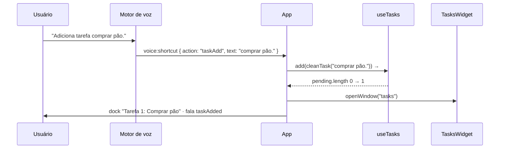

# Tarefas

Widget com a lista de afazeres do dia, numerada para ser dita, que o JARVIS mantém por voz sem passar pelo Claude e que se abre sozinha quando há pendência.

| | |
|---|---|
| **ID** | `widget/tasks` |
| **Status** | Implementado · não commitado |
| **Origem** | não commitado (27/10) |
| **Window kind** | `tasks` em `src/lib/desktop.ts` (320 × 300, mínimo 240 × 180, grupo `widgets`) |
| **Voz** | `window:tasks` ("tarefas", "lista de tarefas", "to do list", "todo list", "afazeres", "pendências", "checklist"), `shortcut:tasks`, `shortcut:taskAdd`, `shortcut:taskDone`, `shortcut:taskRemove`; `shortcut:reminder` sem horário vira tarefa |

## Visão geral

Tarefas é a lista de afazeres do dia. Cada item tem um número curto para ser dito ("conclui a tarefa 2"), pode ser marcado como feito, editado ou apagado no widget, e o JARVIS faz o mesmo por voz sem passar pelo Claude. As tarefas feitas somem no dia seguinte, e as pendentes ficam. A lista se abre sozinha sempre que o número de pendências sobe, inclusive ao iniciar o app com algo por fazer. O Claude também mexe nela pelas tools `tasks_*`, quando o pedido chega como fala livre ou anotação.

## Dados

- `$tarefas`: a lista de **Task**, `{ id, text, done }`, com `done` em `AAAA-MM-DD` ou `null`. Fica em `jarvis.tasks`, gravada sem debounce (`delay = 0`). Ver [glossário](../../domain/glossary.md) e [persistência](../../domain/persistence.md).
  - **RF-001**: Cada tarefa DEVE ter id numérico (o menor livre, que nunca muda), texto e `done` (data em que foi feita ou nulo).
  - `idOf` aceita `"3"` e `"#3"` como id. As feitas antes de hoje saem ao ler.
  - Se o dado salvo estiver corrompido, então `parseTasks` descarta os itens sem texto, com `done` que não seja data válida ou com id inválido ou repetido, e corta a lista em 100.
- `$hoje`: a data de hoje (`dateKey`), renovada à meia-noite. Só em memória.
- `$pendentes`: as tarefas de $tarefas com `done` nulo.

## Componentes

### `useTasks`

O hook que guarda $tarefas e valida cada mudança. Ele vive no `App`, então voz, tools e widget usam as mesmas funções.

- **Comportamento:**
  - `add(texto)` põe a tarefa no fim, com o menor número livre (`smallestFreeId`), e devolve a tarefa ou o que está errado.
    - O texto passa por `tidy`: espaços repetidos viram um, e o máximo é 160 caracteres.
    - Se o texto ficar vazio, então responda "Falta a tarefa".
    - Se a lista tiver 100 tarefas, então responda "A lista está cheia (100)".
  - `setDone(id, done = true)` marca a tarefa como feita hoje, ou de volta a pendente. Devolve a tarefa, ou `null` se não havia.
  - `update(id, texto)` troca o texto, com o mesmo `tidy`. Se a tarefa sumiu, então responda "Essa tarefa não existe mais".
  - `remove(id)` apaga e devolve a tarefa, ou `null` se não havia.
  - `find(número ou palavras)` acha a tarefa pelo número ou pelas palavras (`findByWords`).
    - Nas palavras, contam só as com mais de 2 letras, e pelo menos metade delas precisa estar no texto da tarefa. Ganha a tarefa com mais palavras em comum.
  - `list()` devolve a lista do momento, já com a última mudança.
  - Cada mudança grava em `latest.current` antes do React, para que duas mudanças seguidas vejam a lista nova (RNF-001).

### Virada do dia

- **Comportamento:**
  - **RF-002**: As tarefas feitas antes de hoje DEVEM sair da lista ao carregar e à meia-noite.
    - Ao ler, `parseTasks` aplica `leftOn($hoje)`: ficam as pendentes e as feitas hoje.
    - Um único `setTimeout` vai até a meia-noite mais 1 s e renova $hoje. Então as feitas no dia anterior saem da lista.

### Abertura automática (`App`)

- **Comportamento:**
  - **RF-003**: O `App` DEVE abrir o widget sempre que o total de pendentes subir em relação ao valor anterior (começando de 0).
    - Por isso o widget abre ao iniciar o app com algo pendente e quando uma tarefa nova chega (por voz, tool ou desmarcando uma feita).
    - Se só houver tarefas feitas hoje, então o widget não abre ao iniciar.

### `TasksWidget`

A lista do dia, com a contagem no cabeçalho.

- **Comportamento:**
  - O cabeçalho mostra "hoje · <dia da semana>, dd/mm" (por exemplo "hoje · ter., 03/11") e, com a lista não vazia, "<feitas> de <total>" à direita.
  - Se a lista estiver vazia, então mostre "Nada para hoje. Diga “Jarvis, adiciona tarefa comprar pão” ou digite abaixo."
  - Cada linha mostra `#N`, a caixa e o texto.
  - Um clique na caixa `[ ]` marca a tarefa como feita (`[x]`, texto riscado). Um clique em `[x]` volta a tarefa a pendente.
  - Um duplo clique no texto, ou o lápis "Editar <texto>", abre a edição na linha.
  - O X "Apagar <texto>" apaga a tarefa.
  - Se uma mudança der erro, então a mensagem aparece embaixo da lista.
- **Layout:**
  - Uma coluna com o `ReverseRow` no topo, a lista "Tarefas do dia" no meio, que rola quando não cabe, e o formulário embaixo.
  - Cada linha tem o número (3 caracteres, alinhado à direita), a caixa (`role="checkbox"`, com o texto como nome acessível), o texto, o lápis e o X.
- **Estilo:**
  - Tudo em `font-mono` 12 px, com o texto selecionável.
  - O `ReverseRow` é `bg-hud-light/80`, 11 px, `font-semibold`, `text-hud-void`.
  - O `#N` fica em `text-hud-text/45`, com números tabulares.
  - A caixa fica em `text-hud-cyan` e em `text-hud-light` no hover ou no foco.
  - O texto pendente fica em `text-hud-text`. O feito fica em `text-hud-text/40` e riscado (`line-through`). Os dois são cortados com reticências.
  - O lápis (10 px) e o X (11 px) ficam invisíveis até o hover da linha ou o foco, em `text-hud-text/40`. No hover, o lápis fica `text-hud-light` e o X `text-hud-alert`.
  - O texto da lista vazia fica em `text-hud-text/55`. O erro fica em 11 px, `text-hud-alert/85`.

### Edição na linha (`EditField`)

O campo do kit TUI que troca o texto de uma tarefa no lugar.

- **Comportamento:**
  - Ao abrir, o campo "Editar tarefa N" ganha foco e o texto fica selecionado.
  - `Enter`, ou sair do campo, salva (`update`). `Esc` cancela e mantém o original. Só uma das três responde.
  - Enquanto digita, as teclas da janela (Ctrl+W) esperam.
  - O campo aceita até 160 caracteres.
- **Layout:** o campo ocupa o lugar do texto, entre a caixa e o lápis.
- **Estilo:** transparente, com borda `hud-light/50`, `px-1` e texto `text-hud-text`.

### Formulário "Nova tarefa"

- **Comportamento:**
  - Ao `Enter` no campo "Nova tarefa", chame `add` e limpe o campo.
  - Um texto vazio não é enviado.
  - Se `add` devolver um erro, então mostre-o acima do formulário.
  - O campo aceita até 160 caracteres.
- **Layout:** embaixo do widget, separado por uma borda: o prompt `+` e o campo (placeholder "Nova tarefa").
- **Estilo:** borda superior `hud-cyan/10`, o `+` em `text-hud-cyan` e o campo transparente, com o placeholder em `text-hud-text/30`.

### Tools `tasks_*` do JARVIS

- **Comportamento:**
  - **RF-007**: As tools `tasks_add`, `tasks_list`, `tasks_done` e `tasks_remove` DEVEM agir sobre o mesmo estado, e `tasks_add` abre o widget.
  - `tasks_add` põe `text` na lista, abre o widget, mostra "Tarefa N: …" no dock e responde "Na lista como tarefa N: …". Com texto em branco, responda `ok: false`.
  - `tasks_list` devolve `tasksReport`: `N: [ ] texto` / `N: [x] texto`, ou "A lista de tarefas está vazia.".
  - `tasks_done` marca `id` como feita ("Feita: N, texto"), ou pendente com `done: false` ("De volta a pendente: …").
  - `tasks_remove` apaga `id` e responde "Apagada: N, texto".
  - Se o `id` de `tasks_done` ou `tasks_remove` não existir, então responda `ok: false` ("Nenhuma tarefa com esse número (veja tasks_list)").

## Voz e teclado

- **RF-004**: Os atalhos `tasks`, `taskAdd`, `taskDone` e `taskRemove` DEVEM agir na hora, com aviso no dock e fala do JARVIS, sem chamar o Claude.
  - `shortcut:taskAdd` ("adiciona tarefa", "nova tarefa", "coloca na lista", "anota na lista"…): `add(cleanTask(text))`; dock "Tarefa N: <texto>" e fala `taskAdded` (ex.: "Na lista, Tony: Comprar pão. Número 1.") / `taskNotAdded`.
    - `cleanTask` arruma o ditado: "que preciso comprar pão." vira "Preciso comprar pão". O "que", "de", "pra" ou "para" inicial e a pontuação nas pontas saem, e a primeira letra fica maiúscula.
    - Se a lista estiver cheia, então o JARVIS diz que não conseguiu pôr na lista e explica o motivo.
  - `shortcut:taskDone` ("conclui a tarefa", "risca a tarefa", "terminei a tarefa"…): `find(número ou palavras)` → `setDone`; dock "Tarefa N concluída"; `taskDone` / `taskNotFound`.
  - `shortcut:taskRemove` ("remove a tarefa", "apaga a tarefa", "tira da lista"…): `find` → `remove`; dock "Tarefa N apagada"; `taskRemoved` / `taskNotFound`.
    - Se a tarefa não existir, então o JARVIS diz que não há a tarefa ("número 7" ou as palavras ditas).
  - `shortcut:tasks` ("minhas tarefas", "o que eu tenho pra fazer", "o que falta fazer"…): abre o widget; `tasksLine` lê só as pendentes.
- **RF-005**: `taskDone` e `taskRemove` DEVEM aceitar o número (`leadingNumber`) ou as palavras (`findByWords`).
  - `leadingNumber` entende "dois", "número três", "#4" e "o item 12". Um número no meio do texto ("de comprar um pão") não é id.
  - Se a frase for só "remove a tarefa", sem número nem texto, então o matcher abre a lista (`window:tasks`).
- **RF-006**: O atalho `reminder` sem tempo reconhecível e sem dia ou horário (`mentionsWhen`) DEVE virar tarefa.
  - "Me lembra de ligar para a Ana" vira a tarefa "Ligar para a Ana" (`addTask`), não um lembrete. Ver [reminders](../../features/reminders/spec.md).
- `window:tasks` ("tarefas", "lista de tarefas", "to do list"…): abre ou fecha o widget.
- Duplo clique / lápis: `EditField` (`Enter` ou blur salva, `Esc` cancela).
- `Enter` no campo "Nova tarefa": adiciona a tarefa.

## Restrições

- **RNF-001**: O estado fica em `jarvis.tasks` e é gravado sem debounce. Duas mudanças seguidas veem a lista nova (`latest.current`).
- 100 tarefas; 160 caracteres por tarefa.

## Histórias de usuário

### US1 — Manter a lista à mão (P1)

Como usuário, quero adicionar, marcar, editar e apagar tarefas no widget.

**Por que P1:** é a função básica da lista.
**Teste independente:** `tests/tasks.spec.ts` — `the list by hand: added, ticked, edited and deleted, kept, and open by itself while something is pending`.

**Aceite**

1. **Dado** a lista vazia, **então** vejo "Nada para hoje. Diga “Jarvis, adiciona tarefa comprar pão” ou digite abaixo."
2. **Dado** o campo "Nova tarefa", **quando** adiciono "Comprar pão", "Ligar para a Ana" e "Pagar a luz", **então** a lista "Tarefas do dia" mostra `#1`, `#2` e `#3`.
3. **Dado** a caixa `[ ]` de "Comprar pão", **quando** clico, **então** ela vira `[x]`, o texto fica riscado e o cabeçalho mostra "1 de 3" à direita de "hoje · <dia da semana>, dd/mm".
4. **Dado** um duplo clique no texto (ou o lápis "Editar <texto>"), **quando** digito e aperto Enter, **então** o texto muda. Esc mantém o original.
5. **Dado** o X "Apagar <texto>", **então** a tarefa some e `jarvis.tasks` guarda o resto.
6. **Dado** o `#3` apagado, **quando** adiciono "Regar as plantas", **então** ela recebe o `#3`, o menor número livre.

### US2 — A lista aparece quando há o que fazer (P1)

Como usuário, quero ver a lista sem pedir sempre que houver tarefa pendente.

**Por que P1:** é o que faz a lista ser lembrada.
**Teste independente:** `tests/tasks.spec.ts` — `the list by hand: …` e `nothing pending, nothing opens`.

**Aceite**

1. **Dado** tarefas pendentes, **quando** fecho o widget e recarrego o app, **então** ele abre sozinho.
2. **Dado** só tarefas feitas hoje, **quando** o app inicia, **então** o widget não abre.
3. **Dado** o widget fechado, **quando** uma tarefa nova chega (por voz, tool ou desmarcando uma feita), **então** ele abre.

### US3 — Pela voz, sem o Claude (P1)

Como usuário, quero ditar, concluir, apagar e ouvir as tarefas na hora.

**Por que P1:** é o uso principal por voz, e é instantâneo.
**Teste independente:** `tests/tasks.spec.ts` — `by voice: added, ticked by number, deleted by its words, read back; a reminder without a when is a task`.

**Aceite**

1. **Dado** "Adiciona tarefa comprar pão.", **então** a tarefa entra como "Comprar pão" (`#1`), o widget abre, o dock mostra "Tarefa 1: Comprar pão" e o JARVIS confirma (ex.: "Na lista, Tony: Comprar pão. Número 1.").
2. **Dado** "Me lembra de ligar para a Ana" (sem quando), **então** vira a tarefa `#2` "Ligar para a Ana", não um lembrete.
3. **Dado** "Conclui a tarefa dois.", **então** a `#2` fica feita, o dock mostra "Tarefa 2 concluída" e o JARVIS confirma.
4. **Dado** "Quais são minhas tarefas?", **então** o widget abre e o JARVIS lê só as pendentes: "1 tarefa pendente … número 1, Comprar pão".
5. **Dado** "Apaga a tarefa de comprar pão", **então** a tarefa é achada pelas palavras e apagada ("Tarefa 1 apagada" no dock).
6. **Dado** "Remove a tarefa 7", **então** o JARVIS diz que não há a tarefa "número 7".
7. **Dado** essas frases, **então** nenhuma delas chama o Claude.
8. **Dado** "remove a tarefa" sem número nem texto, **então** a lista só abre.

### US4 — O JARVIS usa a lista (P2)

**Teste independente:** `tests/tasks.spec.ts` — `JARVIS's tools for the list: add (the widget opens), list, done, remove`.

**Aceite**

1. **Dado** `tasks_add { text: "Renovar o passaporte" }`, **então** a resposta é "Na lista como tarefa 1: Renovar o passaporte" e o widget abre. Com texto em branco, `ok: false`.
2. **Dado** `tasks_done { id: 2 }`, **então** "Feita: 2, Levar o carro na revisão". Com `done: false`, "De volta a pendente: …".
3. **Dado** `tasks_list`, **então** `1: [ ] Renovar o passaporte\n2: [x] Levar o carro na revisão`.
4. **Dado** `tasks_remove { id: 9 }` inexistente, **então** `ok: false`.

### US5 — Virada do dia (P2)

**Teste independente:** `tests/tasks.spec.ts` — `the next day: what was done yesterday is gone, what is still to do stays`.

**Aceite**

1. **Dado** uma tarefa feita ontem, uma pendente de ontem e uma feita hoje, **quando** o app abre, **então** restam duas: a pendente e a feita hoje.
2. **Dado** o app aberto à meia-noite, **então** as feitas no dia anterior saem da lista (cerca de 1 s depois da meia-noite).

## Critérios de sucesso

- **SC-001**: Adicionar, concluir e apagar por voz responde sem esperar o Claude.
- **SC-002**: Uma tarefa pendente nunca fica esquecida: a lista aparece a cada início do app.

## Fora de escopo e limitações

- Sem prazos, prioridades ou subtarefas. Com dia ou horário, é compromisso da [Agenda](../../widgets/agenda/spec.md).
- Por voz só se conclui (`taskDone`). Para voltar uma tarefa a pendente, é preciso clicar ou usar a tool com `done: false`.
- O roteiro da chegada em casa e o briefing (que leem a lista) são de [voice-shortcuts](../../features/voice-shortcuts/spec.md).

## Código

`useTasks` vive no `App` e guarda a lista em `jarvis.tasks` (sem debounce). As mutações (`add`, `setDone`, `update`, `remove`) validam, devolvem a tarefa ou uma mensagem e atualizam `latest.current` antes do React. `today` muda num `setTimeout` agendado para a meia-noite, e um efeito tira as feitas antes de hoje. O `App` observa `pending.length` e abre o widget sempre que ele sobe. Os atalhos de voz são resolvidos no próprio `App`, com helpers de `shortcuts.ts` (`leadingNumber`, `cleanTask`, `mentionsWhen`) e de `tasks.ts` (`findByWords`), e falas de `jarvisLines.ts`. As tools `tasks_*` usam o mesmo hook.

| | |
|---|---|
| **Camadas** | UI React (`TasksWidget.tsx`) · hook (`useTasks`) · lib (`tasks.ts`, `shortcuts.ts`, `jarvisLines.ts`) · integração no `App` · tools MCP |
| **Dependências** | `normalize` de `src/lib/search.ts`; `dateKey`/`isDate` de `src/lib/agenda.ts`; kit TUI (`EditField`, `ReverseRow`) |
| **Testes** | `tests/tasks.spec.ts`, `tests/feeds.spec.ts` (briefing); Rust `src-tauri/src/voice/matcher.rs` |
| **Plataforma** | Windows 11 · WebView2; no modo web funciona igual, com voz e tools pelas sondas `__JARVIS__.voiceShortcut` e `__JARVIS__.action` |

### Arquivos

| Arquivo | Papel |
|---|---|
| `src/lib/tasks.ts` | `Task`, `smallestFreeId`, `idOf`, `findByWords`, `tasksReport` |
| `src/hooks/useTasks.ts` | `parseTasks`, `leftOn`, `tidy`, timer da meia-noite, `add`, `setDone`, `update`, `remove`, `find`, `list`, `pending` |
| `src/components/desktop/widgets/TasksWidget.tsx` | cabeçalho "hoje · …" com "N de M", lista com caixa, edição (`EditField`), lápis e X, formulário |
| `src/components/desktop/widgets/tui.tsx` | `EditField` (Enter/blur salva, Esc cancela, segura as teclas da janela) |
| `src/lib/shortcuts.ts` | `leadingNumber`, `cleanTask`, `mentionsWhen` |
| `src/lib/jarvisLines.ts` | `taskAdded`, `taskNotAdded`, `taskDone`, `taskRemoved`, `taskNotFound`, `tasksList`, `tasksEmpty`, `tasksLine`, `dayLine` |
| `src/App.tsx` | `useTasks()`, abertura automática, `addTask`, atalhos `tasks`, `taskAdd`, `taskDone`, `taskRemove` e `reminder` sem tempo |
| `src/hooks/useAssistantActions.ts` · `src-tauri/src/mcp.rs` | tools `tasks_add`, `tasks_list`, `tasks_done`, `tasks_remove` |

### Contratos

#### Ferramentas MCP (JARVIS)

| Tool | O que faz |
|---|---|
| `tasks_add` | põe `text` na lista, abre o widget, dock "Tarefa N: …"; "Na lista como tarefa N: …" |
| `tasks_list` | `tasksReport`: `N: [ ] texto` / `N: [x] texto`, ou "A lista de tarefas está vazia." |
| `tasks_done` | marca `id` como feita, ou pendente com `done: false` |
| `tasks_remove` | apaga `id`; "Apagada: N, texto" |

### Fluxo

### Constituição

- [x] P1 Offline-first: a lista e os atalhos de voz são locais, sem Claude.
- [ ] P2/P3/P4: não se aplicam, porque não há comando Tauri. As tools vêm pelo MCP (ver [assistant-tools](../../features/assistant-tools/spec.md)).
- [x] P5 Persistência tolerante: `parseTasks` descarta itens sem texto, com `done` que não seja data válida ou com id inválido/repetido, aplica a virada do dia e corta em 100.
- [x] P6 Funciona fora do Tauri: só UI e `localStorage`.
- [x] P7 PT-BR: "Nova tarefa", "Tarefas do dia", "hoje · …", mensagens de validação, avisos do dock e falas.
- [x] P8 Linguagem visual: `[ ]` / `[x]` como caixa de seleção, `#N` esmaecido, `ReverseRow`, `EditField` do kit TUI.
- [x] P9 Desktop leve: um só `setTimeout` até a meia-noite.
- [x] P11 Coberto por teste: lista à mão, abertura automática, virada do dia, voz, tools e helpers.

### Decisões relacionadas

- [ADR-0003 — motor de voz numa thread Rust](../../arch/adr/0003-motor-de-voz-thread-rust.md)
- [ADR-0004 — catálogo de voz e fallback para o JARVIS](../../arch/adr/0004-catalogo-de-voz-compartilhado-e-fallback.md)
- [ADR-0008 — MCP HTTP in-process](../../arch/adr/0008-mcp-http-in-process.md)
- [ADR-0010 — settings.json vs localStorage](../../arch/adr/0010-persistencia-settings-vs-localstorage.md)
- [ADR-0014 — linguagem visual TUI](../../arch/adr/0014-linguagem-visual-tui.md)

## Tarefas

Legenda: `[x]` feito · `[ ]` pendente · `[P]` pode rodar em paralelo (arquivos diferentes) · `[USn]` história desta spec. As tarefas foram reconstruídas do código e do commit de origem.

### Fase 1 — Base

- [x] T001 Tipo `Task`, `smallestFreeId`, `idOf`, `findByWords`, `tasksReport` — `src/lib/tasks.ts`
- [x] T002 [P] `EditField` no kit TUI — `src/components/desktop/widgets/tui.tsx`
- [x] T003 [P] `tasks` em `WINDOW_SPECS` (320 × 300, mín. 240 × 180), palavras de busca, `window:tasks` e `shortcut:task*` — `src/lib/desktop.ts`, `src/lib/commands.ts`, `src-tauri/voice-commands.json`

### Fase 2 — US1 Lista à mão (P1)

- [x] T004 [US1] `useTasks`: `jarvis.tasks`, `parseTasks`, `tidy`, `add`, `setDone`, `update`, `remove`, `list`, `pending` — `src/hooks/useTasks.ts`
- [x] T005 [US1] Widget: cabeçalho com contagem, caixas `[ ]`/`[x]`, edição inline, lápis, X e formulário "Nova tarefa" — `src/components/desktop/widgets/TasksWidget.tsx`

### Fase 3 — US2 Abrir quando há pendência (P1)

- [x] T006 [US2] Efeito no `App` que abre `tasks` quando `pending.length` sobe — `src/App.tsx`

### Fase 4 — US3 Pela voz (P1)

- [x] T007 [US3] `leadingNumber`, `cleanTask` e `mentionsWhen` — `src/lib/shortcuts.ts`
- [x] T008 [US3] Falas `task*` e `tasksLine` — `src/lib/jarvisLines.ts`
- [x] T009 [US3] `addTask` e os casos `tasks`, `taskAdd`, `taskDone`, `taskRemove` e `reminder` sem tempo — `src/App.tsx`

### Fase 5 — US4 Tools do JARVIS (P2)

- [x] T010 [US4] [P] Declarar `tasks_add`, `tasks_list`, `tasks_done` e `tasks_remove` — `src-tauri/src/mcp.rs`
- [x] T011 [US4] Executar as tools; `tasks_add` abre o widget — `src/hooks/useAssistantActions.ts`

### Fase 6 — US5 Virada do dia (P2)

- [x] T012 [US5] `leftOn` ao ler e o timer da meia-noite (+1 s) — `src/hooks/useTasks.ts`

### Fase 7 — Testes

- [x] T013 Playwright `tests/tasks.spec.ts` — "task helpers: numbers said, appointments spotted, words tidied, the lowest free id"
- [x] T014 Playwright `tests/tasks.spec.ts` — "the list by hand: added, ticked, edited and deleted, kept, and open by itself while something is pending"
- [x] T015 Playwright `tests/tasks.spec.ts` — "the next day: what was done yesterday is gone, what is still to do stays"
- [x] T016 Playwright `tests/tasks.spec.ts` — "nothing pending, nothing opens"
- [x] T017 Playwright `tests/tasks.spec.ts` — "by voice: added, ticked by number, deleted by its words, read back; a reminder without a when is a task"
- [x] T018 Playwright `tests/tasks.spec.ts` — "JARVIS's tools for the list: add (the widget opens), list, done, remove"
- [x] T019 Playwright `tests/tasks.spec.ts` — "\"repassa minha agenda\": today's events and what is left on the list"
- [x] T020 Playwright `tests/tasks.spec.ts` — "\"acorda, querido, papai chegou\": the lights come on, the widgets light up, JARVIS welcomes him home"
- [x] T021 Playwright `tests/feeds.spec.ts` — "the briefing hands JARVIS the weather, the day's agenda and what is left on the list"
- [x] T022 [P] Rust `src-tauri/src/voice/matcher.rs` — `the_tasks_the_agenda_numbers_and_the_homecoming_by_voice`

## Pendências

- Nenhuma registrada.
