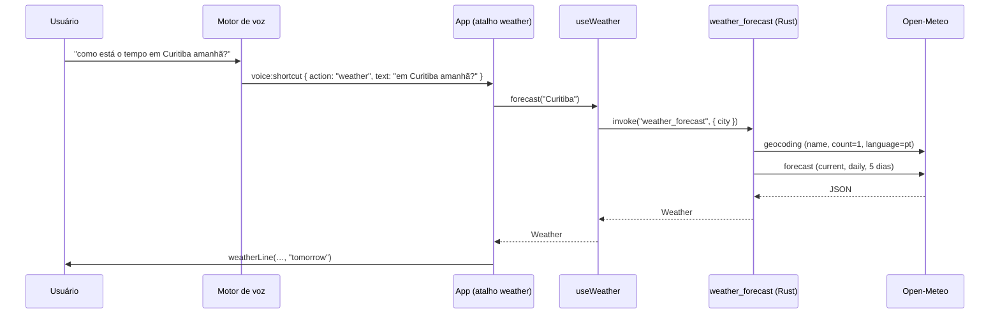

# Clima

Widget com o tempo agora e nos próximos cinco dias na cidade do usuário, que o JARVIS também usa para responder "como está o tempo?".

| | |
|---|---|
| **ID** | `widget/weather` |
| **Status** | Implementado · não commitado |
| **Origem** | não commitado (27/10) |
| **Window kind** | `weather` em `src/lib/desktop.ts` (400 × 230, mínimo 340 × 200, grupo `widgets`) |
| **Voz** | `window:weather` ("clima", "widget do clima", "previsão"), `shortcut:weather` ("previsão do tempo", "como está o tempo", "vai chover", "qual a temperatura"…) |

## Visão geral

O widget mostra temperatura, condição com ícone, sensação, umidade e vento agora e, para cada um dos próximos cinco dias, máxima, mínima e chance de chuva. A cidade é digitada uma vez no próprio widget, ou vem da primeira pergunta ao JARVIS, e fica salva. Pela voz, "como está o tempo [em X] [amanhã]" é respondido na hora pelo JARVIS, sem passar pelo Claude, e o Claude usa a tool `weather` quando precisa da previsão (no briefing, por exemplo). Os dados vêm do Open-Meteo pelo Rust, sem chave de API.

## Dados

- `$cidade`: o texto que o usuário digitou, com até 80 caracteres (`MAX_CITY`). Fica em `jarvis.weather` como `{ city }`, gravado sem debounce (`delay = 0`) e sem migração. `parsePrefs` aceita só `city` string e corta em 80. Ver [persistência](../../domain/persistence.md).
- `$previsão`: a última **Weather** recebida, só em memória: `place`, `current { temperature, apparent, humidity, code, wind, day }` e `days[] { date, code, max, min, rain }`. Ver [glossário](../../domain/glossary.md).
- `$erro` e `$carregando`: o estado da última consulta.

## Componentes

### `WeatherWidget`

Mostra $previsão de $cidade, ou o formulário da cidade quando ainda não há uma.

- **Comportamento:**
  - Se $cidade estiver vazia, mostre o formulário "Sua cidade" (placeholder "Curitiba") com a dica "Enter para consultar. O JARVIS usa essa cidade quando você pergunta do tempo.".
    - Ao Enter, salve o texto em $cidade e volte para a previsão. Um texto vazio não é enviado, então a UI nem chama o Rust.
  - Quando o usuário clicar no lápis "Trocar a cidade", volte ao formulário já preenchido com $cidade e com foco. Ao salvar a nova cidade, limpe a previsão antiga até chegar a nova.
  - **RF-002**: A UI DEVE traduzir códigos WMO em texto e ícone (`describeWeather`): céu limpo, nublado, neblina, garoa, chuva, neve, pancadas, trovoadas, e ícone de lua à noite.
  - Enquanto $carregando, mostre "Consultando o tempo…". Se houver $erro, mostre o erro no lugar da previsão (por exemplo "Não encontrei a cidade “<nome>”" ou, no modo web sem fake, "Disponível no app desktop").
  - Mostre o lugar como o Open-Meteo devolve, mas sem repetir a região igual ao nome: "São Paulo, São Paulo" aparece só como "São Paulo".
- **Layout:**
  - Formulário: centralizado na vertical, com o rótulo "Sua cidade", uma linha com o prompt `$` e o campo, e a dica embaixo.
  - Previsão:
    - `ReverseRow` no topo, com $previsão.place (ou $cidade) à esquerda e o lápis "Trocar a cidade" à direita.
    - Abaixo, a linha de agora: o ícone da condição, a temperatura grande com a condição por baixo e, alinhada à direita, a lista `sensação` / `umidade` / `vento`.
    - Embaixo, a lista "Próximos dias" em cinco colunas: "hoje" e os dias da semana abreviados ("ter", "qua"…), cada um com ícone, máxima, mínima e chance de chuva.
- **Estilo:**
  - Tudo em `font-mono` 12 px (11 px nas listas), com o texto selecionável.
  - A temperatura de agora usa `clamp(26px, 13cqw, 52px)`, acompanha a largura do widget e fica em `text-hud-light`, com números tabulares.
  - O campo da cidade tem só uma borda inferior `hud-cyan/25` e o `$` em `text-hud-cyan`.
  - Os nomes `sensação`, `umidade` e `vento` ficam em `text-hud-cyan`, os ícones dos dias também em `text-hud-cyan` e a máxima em `text-hud-light`.
  - A chance de chuva de 60% ou mais fica em `text-hud-amber`; abaixo disso, em `text-hud-text/40`.
  - O erro fica em `text-hud-alert/85`.

### `useWeather`

O hook que guarda $cidade e busca $previsão. Ele vive no `App`, porque o atalho de voz, o briefing e a tool precisam dele mesmo com o widget fechado.

- **Comportamento:**
  - **RF-003**: O widget DEVE guardar só a cidade (`jarvis.weather`) e atualizar a cada 30 min enquanto estiver aberto e o app visível. Escondido, espera; na volta, uma previsão com mais de 30 min é renovada na hora.
  - `forecast(place?)` consulta `fetchWeather`: o fake `__JARVIS_WEATHER__` em DEV ou o comando `weather_forecast`.
    - Só atualize $previsão do widget quando a cidade pedida for $cidade, ou quando ainda não houver $cidade.
    - Se ainda não houver $cidade e a pergunta citar uma, essa primeira cidade perguntada vira $cidade.
  - **RF-005**: Pedir o tempo de outra cidade NÃO DEVE mudar a cidade do widget, se ela já existir.

### Previsão no Rust (`feeds::weather`)

- **Comportamento:**
  - **RF-001**: O Rust DEVE geocodificar a cidade no Open-Meteo (`count=1`, `language=pt`) e buscar `current` (temperatura, sensação, umidade, código WMO, vento, dia/noite) e `daily` de 5 dias (código, máx., mín., probabilidade de chuva), com `timezone=auto`.
  - Se a cidade não for encontrada, responda "Não encontrei a cidade “<nome>”". Se vier vazia, responda "Diga a cidade".
  - Corte nomes longos em 80 caracteres (`MAX_CITY`).
  - Busque sempre 5 dias (`FORECAST_DAYS`).

### Tool `weather` do JARVIS

- **Comportamento:**
  - **RF-006**: A tool `weather` DEVE devolver `weatherReport`: agora + uma linha por dia, com dia da semana e data.
  - Sem `city`, use $cidade. Se não houver nenhuma das duas, responda `ok: false` pedindo para perguntar a cidade ao usuário.
  - Uma `city` pedida na tool não muda $cidade.

## Voz e teclado

- **RF-004**: O atalho `weather` DEVE abrir o widget quando a pergunta não citar outra cidade ou quando ainda não houver cidade, e responder para hoje ou, se a frase tiver "amanh", para amanhã.
  - Quando o usuário disser uma das frases de `shortcut:weather` ("previsão do tempo", "como está o tempo", "como tá o tempo", "como vai estar o tempo", "como vai ficar o tempo", "como está o clima", "como tá o clima", "vai chover", "qual a temperatura", "qual é a temperatura", "clima"), `placeIn(text)` escolhe a cidade, ignorando "amanhã", "hoje"…, e `/amanh/` escolhe amanhã. A resposta é `weatherLine`.
  - Se ainda não houver $cidade, abra o widget pedindo a cidade e diga algo como "Receio que eu ainda não saiba a sua cidade…".
  - Se a previsão falhar, diga uma das falas `weatherFailed`.
  - Se a frase do atalho não estiver no início ("Qual a previsão do tempo para amanhã?"), a pergunta vai ao JARVIS (fallback), que usa a tool `weather`.
- `window:weather` ("clima", "widget do clima", "previsão") com um verbo abre ou fecha o widget ("abre o clima").
- `Enter` no campo "Sua cidade": salva $cidade (`setCity`).

## Restrições

- **RNF-001**: As requisições saem do Rust com timeout de 10 s e sem chave.
- **RNF-002**: 30 min de intervalo, porque os modelos do Open-Meteo atualizam de hora em hora e o widget pergunta duas vezes por hora (comentário em `useWeather.ts`).

## Histórias de usuário

### US1 — Definir a cidade e ver a previsão (P1)

Como usuário, quero dizer minha cidade uma vez e ver o tempo de agora e dos próximos dias.

**Por que P1:** sem cidade, o widget não tem o que mostrar.
**Teste independente:** `tests/feeds.spec.ts` — `the weather: the widget's city, spoken now and tomorrow, another city on request`.

**Aceite**

1. **Dado** o widget sem cidade, **então** ele mostra o campo "Sua cidade" (placeholder `Curitiba`) e a dica "Enter para consultar. O JARVIS usa essa cidade quando você pergunta do tempo."
2. **Dado** o campo, **quando** digito `curitiba` e Enter, **então** o cabeçalho mostra o lugar resolvido ("Curitiba, Paraná"), a temperatura `15°` com "nublado", e `sensação`, `umidade` e `vento` à direita.
3. **Dado** a previsão carregada, **então** a lista "Próximos dias" tem 5 itens: "hoje" e os dias da semana abreviados, cada um com ícone, máxima, mínima e chance de chuva (60% ou mais em âmbar).
4. **Dado** a cidade salva, **quando** recarrego, **então** `jarvis.weather` mantém `{ city: "curitiba" }` e o widget consulta de novo.
5. **Dado** o widget aberto, **então** a previsão é renovada a cada 30 minutos.

### US2 — Perguntar o tempo por voz (P1)

Como usuário, quero perguntar "como está o tempo?" ou "vai chover amanhã?" e ouvir a resposta.

**Por que P1:** é o uso mais comum por voz.
**Teste independente:** `tests/feeds.spec.ts` — `the weather: the widget's city, spoken now and tomorrow, another city on request`.

**Aceite**

1. **Dado** nenhuma cidade definida, **quando** pergunto "como está o tempo?", **então** o widget abre pedindo a cidade e o JARVIS diz algo como "Receio que eu ainda não saiba a sua cidade… Diga, por exemplo, “clima em Curitiba”."
2. **Dado** a cidade definida, **quando** pergunto "como está o tempo?", **então** o JARVIS diz a temperatura e a condição agora e "Hoje, mínima de 10 e máxima de 19.". Se a chance de chuva for de 30% ou mais, ele acrescenta isso, e com 60% ou mais sugere o guarda-chuva.
3. **Dado** "vai chover amanhã?", **então** a resposta é sobre amanhã (por exemplo, "Amanhã em Curitiba: chuva fraca, entre 12 e 22 graus…") e cita os 76 por cento de chuva.
4. **Dado** "como está o tempo em São Paulo?", **então** o JARVIS responde sobre São Paulo e a cidade do widget não muda.
5. **Dado** a previsão fora do ar, **então** o JARVIS diz uma das falas `weatherFailed` ("Os satélites estão calados no momento…").

### US3 — O JARVIS consulta o clima (P2)

**Teste independente:** `tests/feeds.spec.ts` — `the weather: the widget's city, spoken now and tomorrow, another city on request` e `the briefing hands JARVIS the weather, the day's agenda and what is left on the list`.

**Aceite**

1. **Dado** a tool `weather {}`, **então** o JARVIS recebe a previsão da cidade do widget, que começa por `<lugar>, agora: 15°C (sensação 13°C), nublado, umidade 68%, vento 11 km/h`, e uma linha por dia.
2. **Dado** `weather { city: "Recife" }`, **então** a resposta é de Recife, e `jarvis.weather` continua com a cidade do widget.
3. **Dado** nenhuma cidade no widget e nenhuma na tool, **então** a tool responde `ok: false` pedindo para perguntar a cidade ao usuário.
4. **Dado** o atalho "bom dia" (briefing) com cidade definida, **então** o prompt do JARVIS traz `Clima: Curitiba, agora…`.

### US4 — Trocar a cidade (P3)

**Aceite**

1. **Dado** o widget com previsão, **quando** clico no lápis "Trocar a cidade", **então** volta o campo, já preenchido e com foco. Enter salva a nova cidade e limpa a previsão antiga até chegar a nova.

## Critérios de sucesso

- **SC-001**: Depois de definir a cidade uma vez, "como está o tempo?" é respondido sem pedir nada.
- **SC-002**: Perguntar por outra cidade nunca troca a cidade do usuário.

## Fora de escopo e limitações

- Sem localização automática, sem previsão por hora e sem alertas meteorológicos.
- Unidades fixas: °C e km/h.
- O texto do briefing é do [voice-shortcuts](../../features/voice-shortcuts/spec.md), e a tool MCP em si é descrita em [assistant-tools](../../features/assistant-tools/spec.md).

## Código

`useWeather` vive no `App` e mantém a última previsão em memória. `forecast(place?)` consulta `fetchWeather`. No Rust, `feeds::weather` geocodifica pelo Open-Meteo e busca a previsão numa segunda chamada. As falas ficam em `weatherLine` (`jarvisLines.ts`) e o texto para o Claude em `weatherReport` (`feeds.ts`).

| | |
|---|---|
| **Camadas** | UI React (`WeatherWidget.tsx`) · hook (`useWeather`) · lib (`feeds.ts`, `jarvisLines.ts`, `shortcuts.ts`) · comando Tauri `weather_forecast` · módulo Rust `feeds.rs` · tool MCP `weather` |
| **Dependências** | Open-Meteo (`geocoding-api.open-meteo.com/v1/search` e `api.open-meteo.com/v1/forecast`, sem chave); `ureq` 3 |
| **Testes** | `tests/feeds.spec.ts`; Rust `mod tests` em `src-tauri/src/feeds.rs` e `src-tauri/src/voice/matcher.rs` |
| **Plataforma** | Windows 11 · WebView2; no modo web, fake `__JARVIS_WEATHER__` em DEV (devolve a cidade pedida com a inicial maiúscula) ou o erro "Disponível no app desktop" |

### Arquivos

| Arquivo | Papel |
|---|---|
| `src/components/desktop/widgets/WeatherWidget.tsx` | formulário "Sua cidade", agora (ícone, temperatura, sensação/umidade/vento), lista "Próximos dias" |
| `src/hooks/useWeather.ts` | `city`, `weather`, `error`, `loading`, `forecast(place?)`, `setCity`, intervalo de 30 min |
| `src/lib/feeds.ts` | `Weather`, `fetchWeather`, `describeWeather` (WMO → texto e ícone), `localDay`, `weatherReport` |
| `src-tauri/src/feeds.rs` | `Weather`, `Current`, `Day`, `parse_place`, `parse_forecast`, `weather` |
| `src-tauri/src/lib.rs` | `#[tauri::command] weather_forecast` |
| `src/lib/shortcuts.ts` | `placeIn` (a cidade numa pergunta, ignorando "amanhã", "hoje"…) |
| `src/lib/jarvisLines.ts` | `weatherNow`, `weatherTomorrow`, `weatherRain`, `weatherMaybeRain`, `weatherNoCity`, `weatherFailed`, `weatherLine` |
| `src/App.tsx` | `useWeather({ active: widgetOpen("weather") })`; `case "weather"` do atalho; clima no briefing |
| `src/hooks/useAssistantActions.ts` · `src-tauri/src/mcp.rs` | tool `weather` |

### Contratos

#### Comandos Tauri

| Comando | Entrada | Saída | Notas |
|---|---|---|---|
| `weather_forecast` | `{ city: string }` | `Weather` | via `blocking()`; erros: "Diga a cidade", "Não encontrei a cidade “…”", "Sem resposta de <host>: …", "Resposta inesperada de <host>: …", "Previsão incompleta" |

#### Ferramentas MCP (JARVIS)

| Tool | O que faz |
|---|---|
| `weather` | `weatherReport` da `city` pedida ou, sem ela, da cidade do widget; sem nenhuma, devolve `ok: false` |

### Fluxo

### Constituição

- [x] P1 Offline-first: a rede só é usada para o clima, que é online por natureza. Sem chave de API.
- [x] P2 Rust é dono do nativo: o HTTP sai do Rust, porque a CSP bloqueia outras origens.
- [x] P3 Comandos finos: `weather_forecast` só repassa para `feeds::weather` via `blocking()`.
- [x] P4 Contratos espelhados: `Weather` em `feeds.ts` traz `Mirrors \`Weather\` in src-tauri/src/feeds.rs`. `Current` e `Day` usam `rename_all = "camelCase"`.
- [x] P5 Persistência tolerante: `parsePrefs` aceita só `city` string e corta em 80 caracteres.
- [x] P6 Funciona fora do Tauri: caminhos 2 (`__JARVIS_WEATHER__`) e 3 ("Disponível no app desktop").
- [x] P7 PT-BR: geocodificação com `language=pt`, condições em português, mensagens de erro do Rust e falas.
- [x] P8 Linguagem visual: `ReverseRow`, ícones lucide em `hud-light`/`hud-cyan`, chuva forte em `hud-amber`.
- [x] P9 Desktop leve: o intervalo só existe com o widget aberto, e não busca nada com o app oculto (2026-11-04).
- [x] P11 Coberto por teste: E2E (widget, voz, tool, briefing) e Rust (geocodificação e parse da previsão).

### Decisões relacionadas

- [ADR-0001 — Tauri 2 + Rust](../../arch/adr/0001-tauri-rust-desktop.md)
- [ADR-0004 — catálogo de voz e fallback para o JARVIS](../../arch/adr/0004-catalogo-de-voz-compartilhado-e-fallback.md)
- [ADR-0008 — MCP HTTP in-process](../../arch/adr/0008-mcp-http-in-process.md)
- [ADR-0009 — tipos espelhados TS ↔ Rust](../../arch/adr/0009-tipos-espelhados-ts-rust.md)
- [ADR-0011 — fakes de dev e E2E no modo web](../../arch/adr/0011-fakes-de-dev-e-e2e-modo-web.md)

## Tarefas

Legenda: `[x]` feito · `[ ]` pendente · `[P]` pode rodar em paralelo (arquivos diferentes) · `[USn]` história desta spec. As tarefas foram reconstruídas do código e do commit de origem.

### Fase 1 — Base

- [x] T001 Rust: `Weather`, `Current`, `Day`, `parse_place` (nome + região, sem repetir), `parse_forecast` (5 dias) e `weather` — `src-tauri/src/feeds.rs`
- [x] T002 Comando `weather_forecast` via `blocking()` — `src-tauri/src/lib.rs`
- [x] T003 [P] TS: `Weather` espelhado, `fetchWeather` com fake `__JARVIS_WEATHER__`, `describeWeather`, `localDay`, `weatherReport` — `src/lib/feeds.ts`
- [x] T004 [P] `weather` em `WINDOW_SPECS` (400 × 230, mín. 340 × 200), palavras de busca, `window:weather` e `shortcut:weather` — `src/lib/desktop.ts`, `src/lib/commands.ts`, `src-tauri/voice-commands.json`

### Fase 2 — US1 Cidade e previsão (P1)

- [x] T005 [US1] `useWeather`: `jarvis.weather`, `forecast(place?)` (só a cidade do usuário atualiza o widget), `setCity`, intervalo de 30 min — `src/hooks/useWeather.ts`
- [x] T006 [US1] Widget: formulário "Sua cidade", bloco de agora, lista "Próximos dias", erro e "Consultando o tempo…" — `src/components/desktop/widgets/WeatherWidget.tsx`
- [x] T007 [US1] `useWeather({ active: widgetOpen("weather") })` no `App` — `src/App.tsx`

### Fase 3 — US2 Perguntar por voz (P1)

- [x] T008 [US2] `placeIn` para achar a cidade na pergunta — `src/lib/shortcuts.ts`
- [x] T009 [US2] Falas `weather*` e `weatherLine` (hoje/amanhã, chuva ≥ 30% e ≥ 60%) — `src/lib/jarvisLines.ts`
- [x] T010 [US2] `case "weather"` do atalho: abre o widget quando é preciso, responde sem cidade, cuida de amanhã e de falhas — `src/App.tsx`

### Fase 4 — US3 O JARVIS consulta (P2)

- [x] T011 [US3] [P] Declarar a tool `weather` — `src-tauri/src/mcp.rs`
- [x] T012 [US3] Executar `weather` com a cidade do widget por padrão — `src/hooks/useAssistantActions.ts`
- [x] T013 [US3] Clima no prompt do briefing — `src/App.tsx`, `src/lib/shortcuts.ts`

### Fase 5 — US4 Trocar a cidade (P3)

- [x] T014 [US4] Lápis "Trocar a cidade" com o campo preenchido e `autoFocus` — `src/components/desktop/widgets/WeatherWidget.tsx`

### Fase 6 — Testes

- [x] T015 Playwright `tests/feeds.spec.ts` — "tickers, prices and the weather in words"
- [x] T016 Playwright `tests/feeds.spec.ts` — "JARVIS's lines for the weather, the agenda and a price alert"
- [x] T017 Playwright `tests/feeds.spec.ts` — "the weather: the widget's city, spoken now and tomorrow, another city on request"
- [x] T018 Playwright `tests/feeds.spec.ts` — "the briefing hands JARVIS the weather, the day's agenda and what is left on the list"
- [x] T019 [P] Rust `src-tauri/src/feeds.rs` — `the_forecast_reads_now_and_the_next_days`
- [x] T020 [P] Rust `src-tauri/src/feeds.rs` — `feeds_answer_for_real` (`#[ignore]`, rede real)
- [x] T021 [P] Rust `src-tauri/src/voice/matcher.rs` — `the_weather_the_agenda_and_the_stocks_by_voice`
- [x] T022 [P] Rust `src-tauri/src/voice/matcher.rs` — `what_is_no_command_goes_to_jarvis` ("Qual a previsão do tempo para amanhã?" vai ao JARVIS)

## Pendências

- [x] ~~O intervalo de 30 min continua com o widget aberto e o app oculto (P9).~~ Oculto, espera; na volta, renova se passou de 30 min — `src/hooks/useWeather.ts` (2026-11-04)
- [ ] `feeds_answer_for_real` usa `#[ignore]` sem motivo (P11) — `src-tauri/src/feeds.rs`
