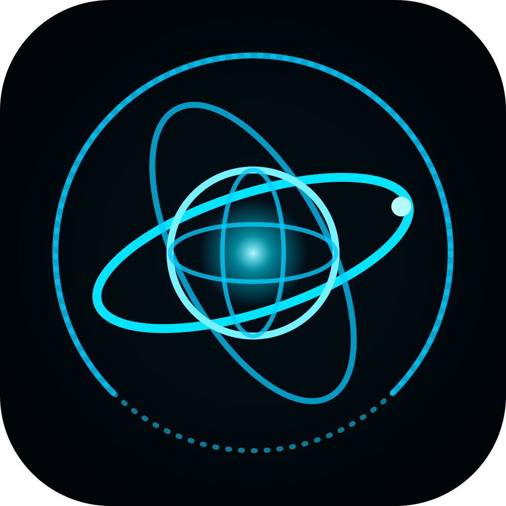

<p align="center">
  
</p>

<h1 align="center">JARVIS OS</h1>

<p align="center">Desktop para Windows inspirado no JARVIS do Homem de Ferro: núcleo holográfico, voz offline e o JARVIS movido a Claude Code.</p>

## Tecnologias

| | |
|---|---|
| Desktop | Tauri 2 · Rust |
| Interface | React 19 · TypeScript · Vite · Tailwind CSS 4 · Three.js |
| Voz | whisper.cpp (ouvir) · sherpa-onnx com Piper/Kokoro (falar) |
| Assistente | Claude Code |
| Apps | CodeMirror 6 · xterm.js |

## O que faz

- Núcleo holográfico (2D ou 3D) que reage à voz.
- Comandos de voz offline: abre programas, sites, pastas, música, lembretes e o Pomodoro.
- JARVIS no Claude Code: responde com voz neural local, pesquisa na web, anota, lembra e cria agentes.
- Dock, barra superior e widgets: relógio, sistema, clima, agenda, tarefas do dia, ações e FIIs.
- Apps em estilo TUI: IDE (jv_ide), terminal (jv_sh), player (jv_T4p3), Markdown (Jarvis Mark), lições de IA (jv_lab) e agentes (jv_agent).

## Requisitos recomendados

**Máquina**

- Windows 11 64-bit (o único testado)
- CPU com 8 threads ou mais (3 a 9 s por comando com o modelo Small num Core 7 150U), ou uma GPU com Vulkan: ~1 s na Intel integrada, ~0,1 s numa NVIDIA MX570
- 16 GB de RAM
- ~15 GB livres em disco para compilar, mais ~1 GB para os modelos de voz
- Microfone e internet (downloads, Claude Code, clima, cotações e música)

**Software**

- WebView2
- Node.js 22+
- Rust stable (MSVC)
- Visual Studio Build Tools com C++ e CMake
- LLVM (`winget install LLVM.LLVM`)
- Vulkan SDK, opcional, para a voz na GPU (`winget install KhronosGroup.VulkanSDK`)
- [Claude Code](https://claude.ai/code) instalado e com login feito

## Rodar

```powershell
npm install
npm run dev           # app com hot reload
npm run tauri build   # instalador
```

A primeira compilação leva alguns minutos por causa do whisper.cpp. Os modelos de voz são baixados nas Configurações.
